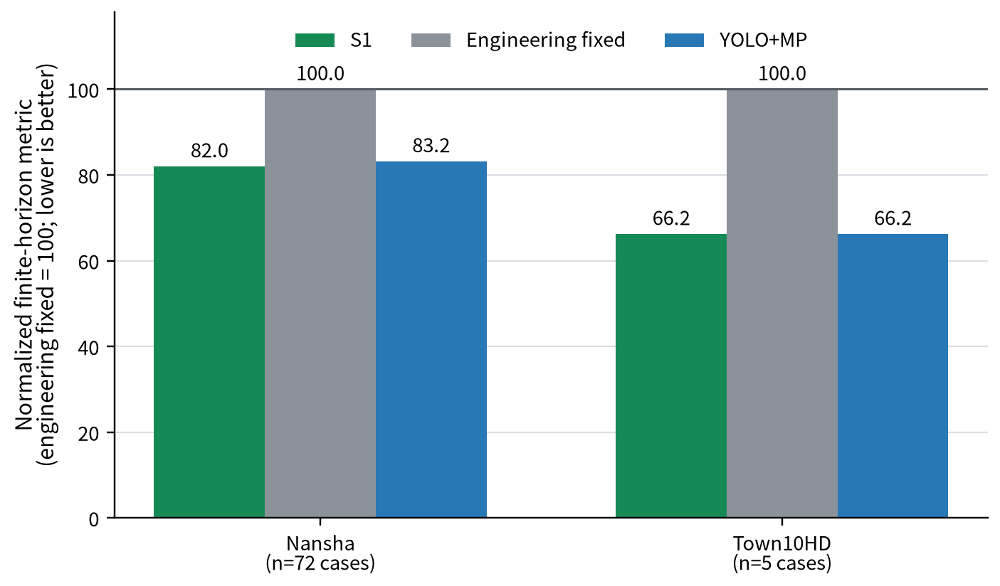
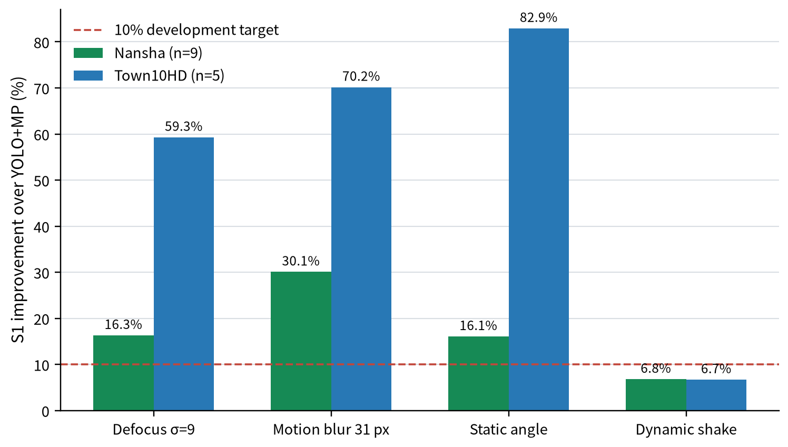
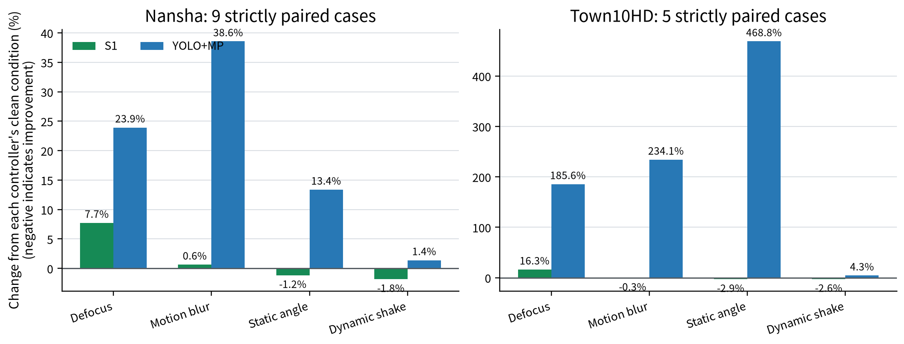
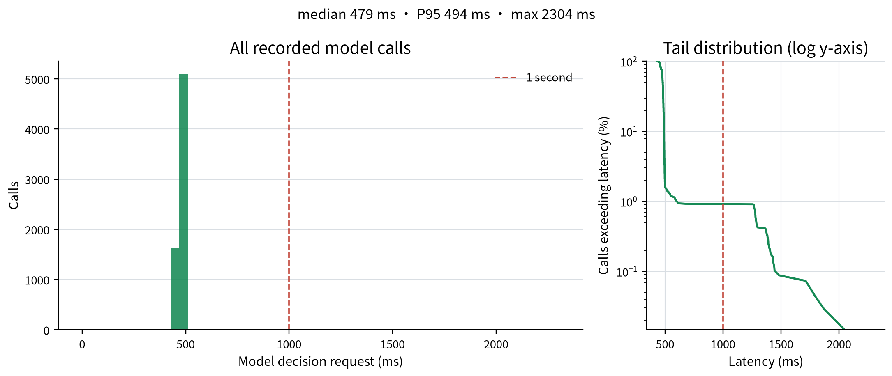

# DeepSignal-S1-1.0

**One vision-to-signal model. Effective on clean traffic scenes, resilient when cameras are not.**

English | [简体中文](README.zh-CN.md)

[Model](https://huggingface.co/AIMS2025/DeepSignal-S1) · [Scenes](https://huggingface.co/datasets/AIMS2025/DeepSignal-S1-Scenes) · [Results](results/fusion-2026-10-30.json) · [Reproduction](docs/reproduction.md)

DeepSignal-S1 directly maps three chronological intersection views and signal context to a legal signal action. The released **DeepSignal-S1-1.0** is one fused checkpoint for both Nansha and Town10HD; it does not require a separate YOLO perception stage.

<!-- FUSION_HIGHLIGHTS:BEGIN -->
- **Effective clean control:** versus frozen engineering timing, S1 reduces the metric by **17.98%** across 72 Nansha cases and **33.77%** across five Town regimes.
- **Robust under visual disruption:** in the single fixed-camera-shift condition, Town improves **82.93%** over YOLO+MP; under 31 px motion blur, Nansha improves **30.09%**.
- **Three-frame BF16 decisions:** 6823 RTX 5090 model calls average **485 ms**, with a 479 ms median.
<!-- FUSION_HIGHLIGHTS:END -->


*Nansha · 31 px motion blur. S1 and YOLO+MP use the same traffic plan and aligned simulation timestamps; the 60-second simulation window plays at 5× speed.*


*Town10HD · fixed yaw ±15° / pitch ±8°. Both arms use the same traffic plan and aligned simulation timestamps; the 60-second simulation window plays at 5× speed.*

## Results

Lower finite-horizon journey metrics are better. Nansha and Town10HD use different metrics and horizons, so their absolute values are **never pooled**. Clean views compare S1, frozen engineering fixed timing and YOLO+MP. Perturbed views compare S1 with YOLO+MP only.

<!-- FUSION_RESULTS:BEGIN -->
### Clean views: three-way comparison

| Scene | n | S1 | Fixed | YOLO+MP | S1 vs fixed | MP vs fixed | S1 vs MP |
|---|---:|---:|---:|---:|---:|---:|---:|
| Nansha | 72 | 7540.24 | 9193.32 | 7648.36 | **17.98%** | **16.81%** | **1.41%** |
| Town10HD | 5 | 10623.80 | 16040.30 | 10625.20 | **33.77%** | **33.76%** | **0.01%** |

### Perturbed views: S1 vs. YOLO+MP only

| Scene | Condition | n | S1 | YOLO+MP | S1 reduction |
|---|---|---:|---:|---:|---:|
| Nansha | Defocus σ=9 | 9 | 1257.39 | 1502.63 | **16.32%** |
| Nansha | 31 px motion blur | 9 | 1174.58 | 1680.04 | **30.09%** |
| Nansha | Fixed yaw ±15° / pitch ±8° | 9 | 1153.65 | 1374.63 | **16.08%** |
| Nansha | Dynamic shake 5° | 9 | 1145.70 | 1229.37 | **6.81%** |
| Town10HD | Defocus σ=9 | 5 | 12351.90 | 30344.40 | **59.29%** |
| Town10HD | 31 px motion blur | 5 | 10592.30 | 35502.50 | **70.16%** |
| Town10HD | Fixed yaw ±15° / pitch ±8° | 5 | 10315.80 | 60438.50 | **82.93%** |
| Town10HD | Dynamic shake 5° | 5 | 10342.50 | 11087.20 | **6.72%** |

Time entries are sums of matched-case metrics (seconds), not one vehicle's mean travel time. Nansha sums capped per-case means at H=1298 s; Town sums capped per-case totals at H=518 s. Reductions use matched metric sums within each scene and condition.
<!-- FUSION_RESULTS:END -->







The Nansha and Town10HD degradation panels use independent vertical scales. Compare numeric labels across panels, not bar heights.

The clean Nansha main table covers all **72** predefined cases across nine intersections. The perturbation pilot is narrower: Nansha uses nine high-flow balanced cases at seed 97001; Town10HD uses five demand regimes at seed 18040. These are controlled simulation results, not claims of universal superiority or statistical significance.

Recorded cases show the actual visual condition and controller behavior; the on-screen score belongs to that recording. Overall effects are defined by the paired tables above, not by requiring every GIF case to be an S1 win.

## Eight Perturbation Views

<details>
<summary>Open the complete Nansha and Town10HD GIF gallery</summary>

| Scene | Defocus σ=9 | Motion blur 31 px |
|---|---|---|
| Nansha |  |  |
| Town10HD |  |  |

| Scene | Fixed yaw ±15° / pitch ±8° | Dynamic shake 5° / roll 2.5° |
|---|---|---|
| Nansha |  |  |
| Town10HD |  |  |

</details>

Lane regions are calibrated on the clean camera pose and then frozen. For `angle15`, the camera is shifted **after calibration**, remains fixed for the episode, and is not recalibrated. `shake5` applies dynamic yaw/pitch peaks of 5° and roll peaks of 2.5°.

Clean videos: [Nansha](https://huggingface.co/datasets/AIMS2025/DeepSignal-S1-Media/resolve/main/media/fusion-1.0/nansha-clean.mp4) · [Town10HD](https://huggingface.co/datasets/AIMS2025/DeepSignal-S1-Media/resolve/main/media/fusion-1.0/town-clean.mp4)

## Inference Performance



<!-- FUSION_LATENCY:BEGIN -->
| Scope | Count | Mean | Median | P95 | Max | Under 1 s |
|---|---:|---:|---:|---:|---:|---:|
| All calls | 6823 | 485.4 ms | 479.0 ms | 494.0 ms | 2304.0 ms | 99.08% |
| First call per run | 133 | 911.1 ms | 495.0 ms | 1460.2 ms | 2304.0 ms | 52.63% |
| Subsequent calls | 6690 | 476.9 ms | 479.0 ms | 493.0 ms | 675.0 ms | 100.00% |
<!-- FUSION_LATENCY:END -->

The unquantized BF16 checkpoint takes three frames over a four-second observation window. Statistics cover 133 S1 cases: 72 Nansha clean cases and 61 fusion-pilot S1 cases. Camera capture, rendering and control execution are excluded. First calls include initialization effects; subsequent calls characterize steady state.

**Deployment direction:** sub-second steady-state decisions on a consumer RTX 5090 make signal-control workstations a practical target. A colleague also reported approximately **900 ms on an RTX 4090** with the unquantized model; its measurement conditions remain unverified, so it is not included in the benchmark. Quantization and edge-device deployment are future work, not demonstrated capabilities. A universal sub-second guarantee has not been established.

## Download and Quickstart

Model and simulation-asset downloads require separate access approvals. Demo GIFs, videos and result data are openly available from [DeepSignal-S1-Media](https://huggingface.co/datasets/AIMS2025/DeepSignal-S1-Media). The release retains the v3 scene assets; use them with the latest GitHub code. Viewing media does not require downloading the scene package.

```bash
python3.12 -m venv .venv-inference
source .venv-inference/bin/activate
pip install -U huggingface_hub
hf auth login
hf download AIMS2025/DeepSignal-S1 --local-dir ./DeepSignal-S1-model

deactivate

git clone https://github.com/AIMS-Laboratory/DeepSignal-S1.git DeepSignal-S1
cd DeepSignal-S1
python3.10 -m venv .venv
.venv/bin/pip install -e '.[test,reproduction,download]'
```

The model server, a real three-frame request that needs no simulator, and closed-loop commands are documented in [Reproduction](docs/reproduction.md). Download the complete model folder; approved access does not create a hosted API. A full fresh-download closed-loop replay has not yet been certified.

## Evaluation Scope

- **Sole fixed baseline:** frozen engineering timing, with Nansha per-intersection plans and Town10HD `31/6/31/6 s`.
- **Signal transitions:** decisions retain a 5 s green tail, followed by 3 s yellow and 2 s all-red where applicable.
- **Finite horizon:** unfinished journeys remain counted; results are not complete-trip averages.
- **Known Nansha limitation:** the retained red-age accounting protocol can over-count one phase's red age after an immediate first switch. Both arms use the same protocol, but this pilot is not a full correctness certification.

See [fusion evaluation](docs/fusion-pilot-evaluation.md), [metric definitions](docs/comparisons.md), and [media delivery](docs/media-delivery.md).

## Historical Releases

Earlier `DeepSignal-S1-1.0-candidate` Nansha results and the separate historical Town checkpoint remain archived with their original protocol labels. They are not weights or scores of the fused 1.0 release. See [historical released results](docs/released-results.md).

Contact: [dalei@scu.edu.cn](mailto:dalei@scu.edu.cn)
