# DeepSignal S1

**Traffic signal decisions, directly from intersection views.**

The visual decision series in the DeepSignal model family · Current release **DeepSignal-S1-1.0**

**S1 stands for System One**, emphasizing fast, direct visual decisions: combining intersection views and signal state to produce legal control actions.

English | [简体中文](README.zh-CN.md) · [DeepSignal family](https://github.com/AIMS-Laboratory/DeepSignal)

[Watch demos](#featured-demos) · [Explore results](#results) · [Try a decision](#download-and-quickstart) · [Request model access](https://huggingface.co/AIMS2025/DeepSignal-S1) · [Full reproduction](docs/reproduction.md)

<!-- FUSION_HIGHLIGHTS:BEGIN -->
## Design and Strengths

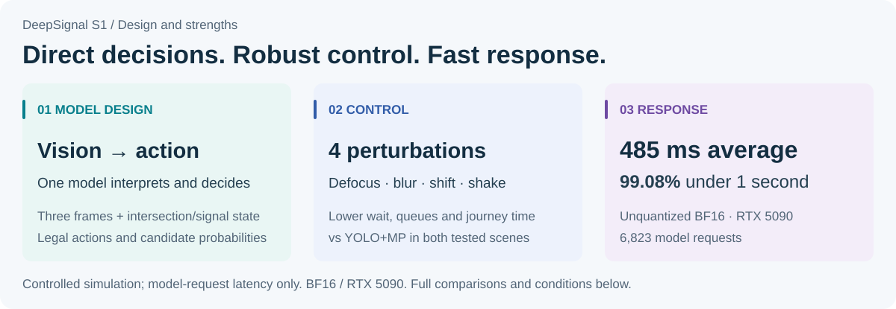

> [!IMPORTANT]
> **Visual understanding and signal decisions in one model.**
> Three temporal frames, intersection information and signal state produce a legal control action and candidate probabilities directly, without a separate vehicle-detection and counting stage.

**Measured speed:** unquantized BF16, RTX 5090, 6,823 requests; **485 ms** on average and **99.08%** under one second. [How it works](#how-it-works) · [Full results](#results) · [Latency statistics](#inference-performance)
<!-- FUSION_HIGHLIGHTS:END -->

Results are from controlled simulations. Latency measures model requests only, excluding camera capture, rendering and signal execution.

## Featured Demos

Watch the visual disturbance, signal actions and queue behavior. These are the existing standard-simulation camera-shift and nine-junction motion-blur recordings, played at **5× speed**. On-screen scores describe that recording; aggregate claims use the paired evaluations. GIFs and static covers are served directly by GitHub without login.

<!-- FUSION_FEATURED:BEGIN -->
### Standard simulation · Fixed yaw ±15° / pitch ±8°

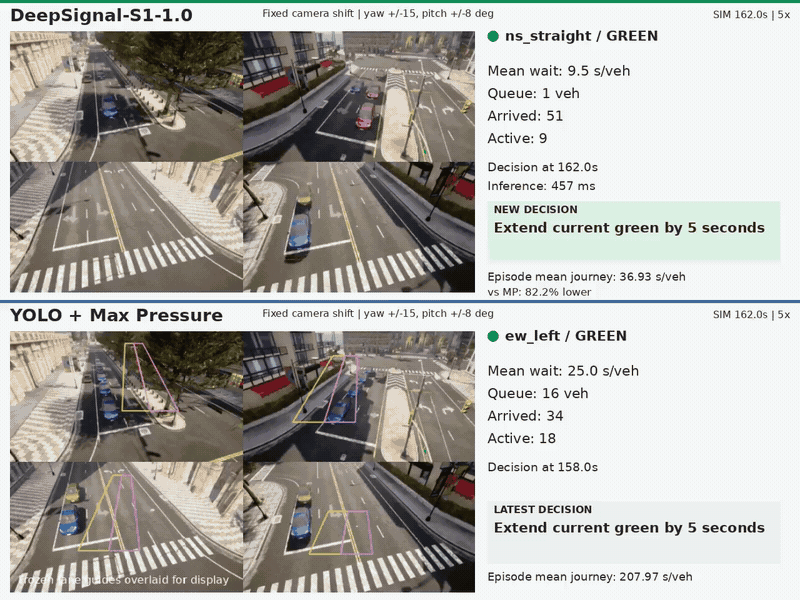

[Watch video](https://github.com/user-attachments/assets/e7b4a406-1474-4d24-9514-ff6d6a2d8e91) · [Static cover](assets/previews/en/town-angle15.jpg)

### Nine-junction test · 31 px motion blur

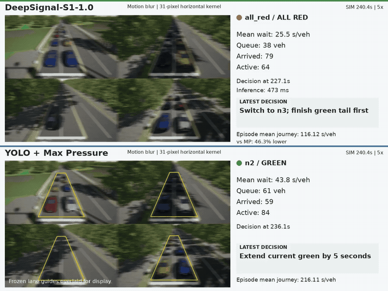

[Watch video](https://github.com/user-attachments/assets/931d0d1f-338f-497d-ab87-d883c54ab54a) · [Static cover](assets/previews/en/nansha-mb31.jpg)
<!-- FUSION_FEATURED:END -->

## Results

**Two evaluation settings, reported separately:**

- **Nine-junction test:** the same model is evaluated separately at nine simulated intersections, including T-junctions and four-arm intersections. Each run controls one junction; these tests do not evaluate coordination between junctions.
- **Standard simulation:** the **Town10HD virtual-city map in CARLA**, with five traffic regimes at one four-arm intersection. Town10HD names the map.

<!-- FUSION_RESULTS:BEGIN -->
This evaluation examines the traffic-control performance of direct visual decisions and the effects of changes in visual input. **YOLO+MP** combines YOLO vehicle detection with Max Pressure signal control; the comparison measures vehicle waiting, queues and journey time.

### Clean views: comparable to YOLO+MP, with small gains on some metrics

Across 72 cases at the nine junctions, S1 reduces mean journey time by 1.36% relative to YOLO+MP; across five standard simulation regimes, mean journey time is essentially tied. Overall, S1 delivers comparable control in clean views, with small gains on some metrics.

The fixed baseline is a **reasonable fixed-time plan optimized through engineering design**, with parameters determined and frozen before evaluation and held unchanged throughout. Against this plan, S1 reduces mean journey time by **18.17%** and **33.77%** in the two settings, respectively.

### Visual perturbations: control performance under input changes

Defocus, blur, camera shifts and shake can affect vehicle detection or lane-region alignment, with expected downstream effects on count-based signal control. In the two settings and four perturbations tested here, S1 records lower mean waiting, queues and journey time than YOLO+MP. Full data and charts covering all eight groups are provided in the results below.

Each perturbation covers one case at each of the nine junctions and five cases in standard simulation, using one seed per scene. YOLO lane regions are calibrated on clean views and frozen; fixed camera shifts are not recalibrated. These results apply to the tested setup and do not establish real-road, night-time or adverse-weather performance.

<details open="open">
<summary>Clean views: three controllers — full values and three-metric chart</summary>

<table>
<thead>
<tr><th scope="col">Scene</th><th scope="col">Condition</th><th scope="col">Cases</th><th scope="col">Controller</th><th scope="col">Mean wait (s/veh)</th><th scope="col">Mean queue (veh)</th><th scope="col">Mean journey (s/veh)</th></tr>
</thead>
<tbody>
<tr><td rowspan="3" align="center" valign="middle">Nine-junction test</td><td rowspan="3" align="center" valign="middle">Clean</td><td rowspan="3" align="center" valign="middle">72</td><td><strong>S1</strong></td><td align="right">45.82</td><td align="right">10.47</td><td align="right">107.32</td></tr>
<tr><td>Fixed-time plan</td><td align="right">68.55</td><td align="right">15.52</td><td align="right">131.15</td></tr>
<tr><td>YOLO+MP</td><td align="right">46.89</td><td align="right">10.56</td><td align="right">108.79</td></tr>
<tr><td rowspan="3" align="center" valign="middle">Standard simulation</td><td rowspan="3" align="center" valign="middle">Clean</td><td rowspan="3" align="center" valign="middle">5</td><td><strong>S1</strong></td><td align="right">20.45</td><td align="right">3.56</td><td align="right">38.22</td></tr>
<tr><td>Fixed-time plan</td><td align="right">40.46</td><td align="right">5.40</td><td align="right">57.70</td></tr>
<tr><td>YOLO+MP</td><td align="right">20.22</td><td align="right">3.59</td><td align="right">38.22</td></tr>
</tbody>
</table>

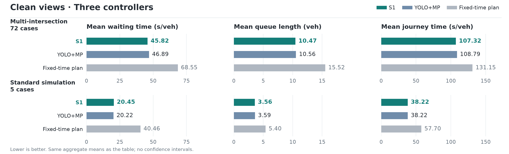

</details>

<details open="open">
<summary>Perturbed views: S1 vs YOLO+MP — full values and three-metric chart</summary>

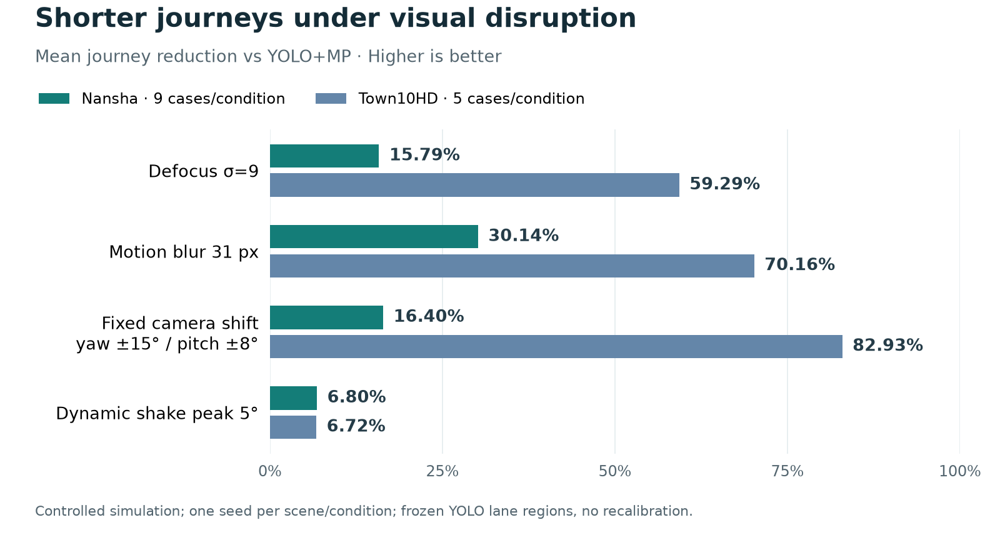

<table>
<thead>
<tr><th scope="col">Scene</th><th scope="col">Condition</th><th scope="col">Cases</th><th scope="col">Controller</th><th scope="col">Mean wait (s/veh)</th><th scope="col">Mean queue (veh)</th><th scope="col">Mean journey (s/veh)</th></tr>
</thead>
<tbody>
<tr><td rowspan="2" align="center" valign="middle">Nine-junction test</td><td rowspan="2" align="center" valign="middle">Defocus σ=9</td><td rowspan="2" align="center" valign="middle">9</td><td><strong>S1</strong></td><td align="right">76.08</td><td align="right">15.79</td><td align="right">141.03</td></tr>
<tr><td>YOLO+MP</td><td align="right">104.86</td><td align="right">31.04</td><td align="right">167.48</td></tr>
<tr><td rowspan="2" align="center" valign="middle">Nine-junction test</td><td rowspan="2" align="center" valign="middle">31 px motion blur</td><td rowspan="2" align="center" valign="middle">9</td><td><strong>S1</strong></td><td align="right">67.38</td><td align="right">17.23</td><td align="right">131.57</td></tr>
<tr><td>YOLO+MP</td><td align="right">124.59</td><td align="right">30.18</td><td align="right">188.34</td></tr>
<tr><td rowspan="2" align="center" valign="middle">Nine-junction test</td><td rowspan="2" align="center" valign="middle">Fixed yaw ±15° / pitch ±8°</td><td rowspan="2" align="center" valign="middle">9</td><td><strong>S1</strong></td><td align="right">63.68</td><td align="right">15.44</td><td align="right">129.04</td></tr>
<tr><td>YOLO+MP</td><td align="right">87.01</td><td align="right">21.18</td><td align="right">154.36</td></tr>
<tr><td rowspan="2" align="center" valign="middle">Nine-junction test</td><td rowspan="2" align="center" valign="middle">Dynamic shake 5°</td><td rowspan="2" align="center" valign="middle">9</td><td><strong>S1</strong></td><td align="right">63.40</td><td align="right">16.17</td><td align="right">128.25</td></tr>
<tr><td>YOLO+MP</td><td align="right">72.15</td><td align="right">17.91</td><td align="right">137.61</td></tr>
<tr><td rowspan="2" align="center" valign="middle">Standard simulation</td><td rowspan="2" align="center" valign="middle">Defocus σ=9</td><td rowspan="2" align="center" valign="middle">5</td><td><strong>S1</strong></td><td align="right">27.51</td><td align="right">4.10</td><td align="right">44.43</td></tr>
<tr><td>YOLO+MP</td><td align="right">92.97</td><td align="right">9.75</td><td align="right">109.15</td></tr>
<tr><td rowspan="2" align="center" valign="middle">Standard simulation</td><td rowspan="2" align="center" valign="middle">31 px motion blur</td><td rowspan="2" align="center" valign="middle">5</td><td><strong>S1</strong></td><td align="right">20.28</td><td align="right">3.58</td><td align="right">38.10</td></tr>
<tr><td>YOLO+MP</td><td align="right">111.26</td><td align="right">10.24</td><td align="right">127.71</td></tr>
<tr><td rowspan="2" align="center" valign="middle">Standard simulation</td><td rowspan="2" align="center" valign="middle">Fixed yaw ±15° / pitch ±8°</td><td rowspan="2" align="center" valign="middle">5</td><td><strong>S1</strong></td><td align="right">19.23</td><td align="right">3.45</td><td align="right">37.11</td></tr>
<tr><td>YOLO+MP</td><td align="right">205.09</td><td align="right">13.67</td><td align="right">217.40</td></tr>
<tr><td rowspan="2" align="center" valign="middle">Standard simulation</td><td rowspan="2" align="center" valign="middle">Dynamic shake 5°</td><td rowspan="2" align="center" valign="middle">5</td><td><strong>S1</strong></td><td align="right">19.13</td><td align="right">3.32</td><td align="right">37.20</td></tr>
<tr><td>YOLO+MP</td><td align="right">21.49</td><td align="right">3.53</td><td align="right">39.88</td></tr>
</tbody>
</table>

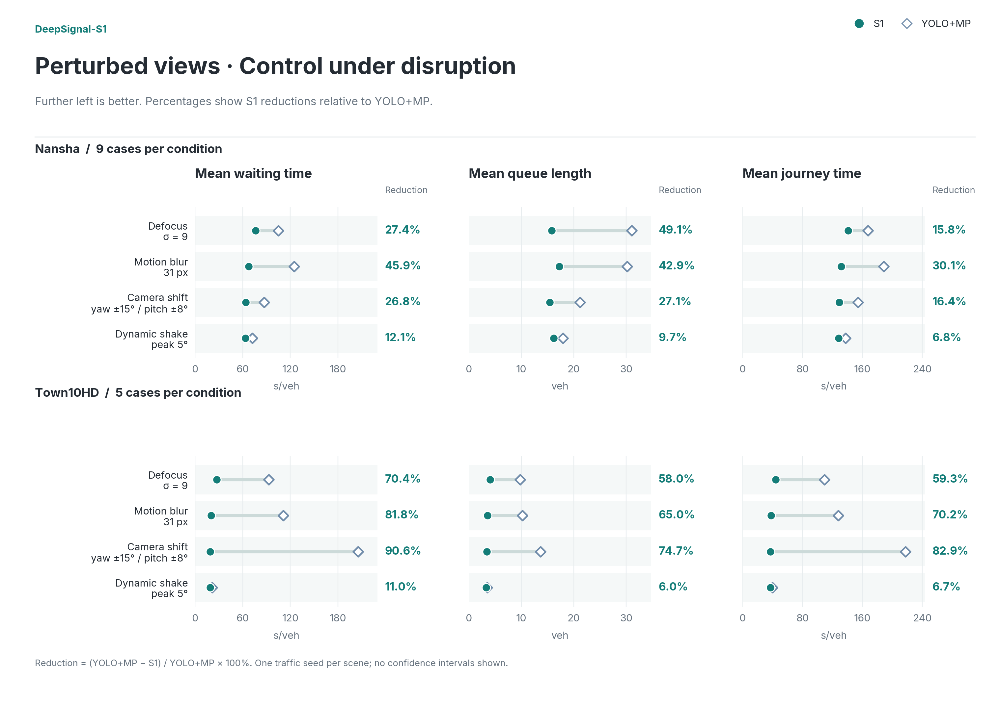

</details>

**Metrics:** lower is better for all three. Mean wait includes stopped and insertion waiting; mean queue counts halted vehicles; journey time starts at planned departure, with unfinished vehicles contributing elapsed time at the evaluation cutoff. [Detailed definitions](docs/traffic-metrics.md).

<details>
<summary>Detailed interpretation and real-world context</summary>

### What the Results Show

#### Clean Views: Assessing the Feasibility of Direct Visual Decisions

In clean views, S1 is broadly comparable to YOLO+MP, with small gains on some metrics; standard-simulation mean journey time is essentially tied. This supports the feasibility of producing signal actions directly from images. Broader evaluation is needed to establish whether the small differences observed across these limited scenes and seeds are consistent.

#### Visual Perturbations: Understanding the Effects of Input Changes

Traffic demand may stay the same while camera input changes because of lighting, maintenance or vibration. The four tests target distinct imaging problems: can S1 continue making effective signal decisions when images lose sharpness or stability, or no longer match the original viewpoint?

- **Defocus: inaccurate focus softens vehicle outlines.** Mixed lighting, including headlights at night, can disrupt autofocus; manual focus adjustment or lens replacement can also leave the intersection out of focus. Softer vehicle and lane edges make recognition and counting harder.
- **Motion blur: movement during exposure creates directional smearing.** In low light at dusk or night, a camera may use longer exposures. Moving vehicles or camera movement during exposure can then smear outlines and obscure separation between vehicles.
- **Fixed camera-angle shifts: a stable view from a changed direction.** For example, maintenance-related re-aiming or a shifted mount can move lane and stop-line positions in the image, even after the camera becomes steady. Previously drawn lane regions may no longer align. Our comparison calibrates YOLO at the original pose, then holds the changed camera angle fixed without recalibration.
- **Dynamic shake: the viewpoint keeps moving over time.** Wind gusts or vibrations from nearby heavy vehicles can shake a pole-mounted camera, shifting vehicle and lane positions across successive frames. Unlike a fixed angle shift, this disturbance continues over time.

These tests examine how visual input changes affect the complete control system. In particular, fixed camera shifts can combine changes in detection quality with lane-region misalignment, so the results should be interpreted in light of the no-recalibration setting. Richer traffic-scene understanding requires dedicated traffic-event evaluations.

The tests simulate visual changes that these real-world problems can produce; they are not completed night-time field or real-world adverse-weather validation. [Real-world context and technical sources](docs/visual-robustness.md).

#### Sub-Second Decisions From a Visual Model

Across **6823** unquantized RTX 5090 decision requests, latency averages **485 ms**, with **99.08%** below one second; steady-state requests average **477 ms**. System One emits structured control actions directly, without waiting for a long textual response, combining visual understanding, traffic-control performance and fast decisions.

</details>
<!-- FUSION_RESULTS:END -->

## How It Works

The model receives three temporal frames (a four-second window sampled every two seconds), static intersection information, current signal state and legal actions. It returns an action and candidate-action probabilities, without simulator vehicle counts or future arrival plans.

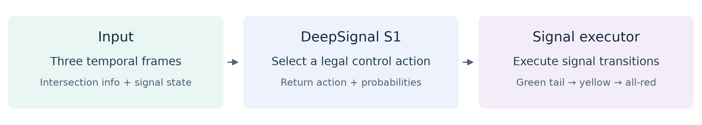

System One emphasizes fast, structured decisions without generating a token-by-token reasoning narrative. S1 draws on the decision paradigm illustrated by [Jev](https://typesafe.ai/blog/introducing-system-one-models-and-jev) and [OneJev](https://github.com/OmniJev/OneJev). It runs locally and does not call the commercial Jev service.

One 1.0 checkpoint covers simulations of nine junctions in the nine-junction evaluation (T-junctions and four-arm intersections) and five traffic regimes at one junction in the standard simulation setting. Training includes these scenes; using one checkpoint across them is not evidence of generalization to unseen intersections.

## Inference Performance

<!-- FUSION_LATENCY:BEGIN -->
| Scope | Count | Mean | Median | P95 | Max | Under 1 s |
|---|---:|---:|---:|---:|---:|---:|
| All calls | 6823 | 485.4 ms | 479.0 ms | 494.0 ms | 2304.0 ms | 99.08% |
| First call per run | 133 | 911.1 ms | 495.0 ms | 1460.2 ms | 2304.0 ms | 52.63% |
| Subsequent calls | 6690 | 476.9 ms | 479.0 ms | 493.0 ms | 675.0 ms | 100.00% |
<!-- FUSION_LATENCY:END -->

Statistics cover 133 S1 evaluation cases and 6823 decision requests with the unquantized BF16 model. Latency measures model decision requests, excluding camera capture, rendering and signal execution; first calls include initialization effects.

**Deployment value:** sub-second model decisions make consumer-GPU signal-control workstations a practical target. We also tested the unquantized model on an **RTX 4090**, observing approximately **900 ms per decision**. This independent observation uses measurement conditions that have not yet been aligned and is not included in the table. Quantization and edge deployment are future directions for reducing compute requirements.

### Runtime Requirements

| Item | Current guidance |
|---|---|
| Precision | Unquantized BF16 |
| Tested inference hardware | RTX 5090; a separate RTX 4090 observation is approximately 900 ms |
| Model server | Linux, NVIDIA GPU, Python 3.12; install dependencies from the complete model package |
| Single decision | Use the included three-frame request; no simulator required |
| Full simulation | Python 3.10, SUMO 1.18.0 and the matching CARLA environment; see reproduction instructions |

A verified minimum-VRAM configuration has not been published; the tested hardware is not a minimum requirement.

## Future Potential and Research Directions

**We see S1's longer-term potential in expanding its decision-making capabilities through scene understanding.** Visual input contains information beyond vehicle counts, such as whether road space is obstructed, which events are causing congestion, and the movement needs of different road users. Combining this information with traffic rules and signal state could support appropriate actions in more complex situations, creating greater room for future capability development.

The current results support the feasibility of direct visual decisions in controlled simulations. **Our team is actively pursuing the following next-stage research directions** to evaluate this potential; complex traffic-event handling and multi-junction coordination have not yet been validated.

- **Progress from observing traffic flows to understanding traffic scenes.** With additional scenario data, traffic rules and safety constraints, explore understanding roadworks, incident blockages, emergency vehicles, and concentrated pedestrian or cyclist flows, assessing their effects on available road space, movement priorities and downstream congestion risk, and adapting signal actions accordingly.
- **Extend single-junction decisions to coordinated control.** Explore sharing queues, signal states and incoming-flow information between adjacent junctions to coordinate release timing, support arterial green waves, limit downstream queue spillback and improve network traffic flow. This requires new communication mechanisms and network-level evaluation.
- **Evaluate broader applicability and reduce deployment costs.** Run independent evaluations at previously unseen junctions, at night and in adverse weather, and explore quantization and edge deployment to assess transferability, response times and compute requirements.

## Download and Quickstart

- **Watch demos:** previews, GitHub videos and [result data](results/fusion-2026-10-30.json) need no approval.
- **Try one decision:** request access on the [model page](https://huggingface.co/AIMS2025/DeepSignal-S1), download the complete model folder, then start the local server below.
- **Run a full simulation:** separately request [scene assets](https://huggingface.co/datasets/AIMS2025/DeepSignal-S1-Scenes) and follow [full reproduction](docs/reproduction.md) for v3 assets and scene-specific environments.

**1. Download and start the model server** (Linux, NVIDIA GPU, Python 3.12; model access approved):

```bash
git clone https://github.com/AIMS-Laboratory/DeepSignal-S1.git
cd DeepSignal-S1
python3.12 -m venv .venv-inference
.venv-inference/bin/pip install -U huggingface_hub
.venv-inference/bin/hf auth login
.venv-inference/bin/hf download AIMS2025/DeepSignal-S1 --local-dir ../DeepSignal-S1-model
.venv-inference/bin/pip install -r ../DeepSignal-S1-model/requirements.txt
.venv-inference/bin/python scripts/serve_model.py --model ../DeepSignal-S1-model --port 18404 --device cuda:0
```

**2. In a second terminal, send the included real three-frame request** (from the same repository directory):

```bash
curl --fail http://127.0.0.1:18404/v1/decide \
  -H 'Content-Type: application/json' \
  --data-binary @examples/nansha-defocus-request.json
```

The server should report `DeepSignal-S1-1.0` and return a selected action with candidate-action probabilities. This request checks inference, not closed-loop traffic performance. Approved model access does not provide a hosted API; a full fresh-download closed-loop replay has not yet been certified.

## Evaluation Scope

- **Engineering-optimized fixed baseline:** a reasonable fixed-time plan optimized through engineering design, with parameters determined and frozen before evaluation and held unchanged throughout. The nine-junction evaluation uses the published per-intersection plans and the standard simulation setting uses `31/6/31/6 s`.
- **Visual comparison:** clean views compare all three controllers; perturbations compare S1 with YOLO+MP. Camera shifts occur after YOLO lane-region calibration, without recalibration.
- **Scope:** results come from the two controlled simulation settings; deployment on real roads and under real weather remains to be validated.

See [evaluation protocol](docs/fusion-pilot-evaluation.md), [metric definitions](docs/comparisons.md), and [media delivery](docs/media-delivery.md).

## Five traffic demand scenarios

<details open="open">
<summary>Expand traffic rates and timing</summary>

<!-- TOWN_DEMAND:BEGIN -->
All five regimes use **the same four-way junction**, varying directional demand, load and peak timing rather than road geometry. The table gives the settings used in the current evaluation.

<table>
<thead>
<tr><th scope="col" nowrap="nowrap">Demand scenario</th><th scope="col" nowrap="nowrap">Flow per approach<br/>(vehicles/hour)</th><th scope="col" nowrap="nowrap">Temporal pattern</th><th scope="col" nowrap="nowrap">Control challenge</th></tr>
</thead>
<tbody>
<tr><td nowrap="nowrap"><a href="https://github.com/AIMS-Laboratory/DeepSignal-S1/blob/main/reproduction/configs/vlm-realtime-control/episode-balanced.formal.json">Balanced flow</a></td><td nowrap="nowrap">All four: 360 each</td><td nowrap="nowrap">Constant throughout</td><td nowrap="nowrap">Basic control with similar<br/>demand in all directions</td></tr>
<tr><td nowrap="nowrap"><a href="https://github.com/AIMS-Laboratory/DeepSignal-S1/blob/main/reproduction/configs/vlm-realtime-control/episode-sustained-uneven.formal.json">Sustained<br/>directional imbalance</a></td><td nowrap="nowrap">E and W: 600 each<br/>N and S: 120 each</td><td nowrap="nowrap">Constant<br/>major/minor ratio 5:1</td><td nowrap="nowrap">Prioritize persistently<br/>busier approaches</td></tr>
<tr><td nowrap="nowrap"><a href="https://github.com/AIMS-Laboratory/DeepSignal-S1/blob/main/reproduction/configs/vlm-realtime-control/ood-uneven125-6001.json">Higher-load<br/>directional imbalance</a></td><td nowrap="nowrap">E and W: 750 each<br/>N and S: 150 each</td><td nowrap="nowrap">Constant<br/>still 5:1</td><td nowrap="nowrap">25% more total demand<br/>than the preceding regime</td></tr>
<tr><td nowrap="nowrap"><a href="https://github.com/AIMS-Laboratory/DeepSignal-S1/blob/main/reproduction/configs/vlm-realtime-control/episode-time-varying.formal.json">Time-varying peak</a></td><td nowrap="nowrap">All approaches:<br/>200 → 700 → 200</td><td nowrap="nowrap">0-60 s<br/>60-120 s<br/>from 120 s</td><td nowrap="nowrap">Adapt to rising demand<br/>and peak recovery</td></tr>
<tr><td nowrap="nowrap"><a href="https://github.com/AIMS-Laboratory/DeepSignal-S1/blob/main/reproduction/configs/vlm-realtime-control/ood-varyshuf-18040.json">Shifted peak timing</a></td><td nowrap="nowrap">All approaches:<br/>200 → 200 → 700</td><td nowrap="nowrap">0-60 s<br/>60-120 s<br/>from 120 s</td><td nowrap="nowrap">Adapt to changes<br/>in peak timing</td></tr>
</tbody>
</table>

Flows are expected arrival rates **per approach**, not per lane or exact hourly vehicle counts; arrivals are sampled randomly. All regimes use 70% straight, 15% left and 15% right turns. Time starts at simulation startup, with the final rate held until demand generation ends. Shifted peak timing reorders the time-varying rates by seed; the table shows the configuration behind the current results. Controllers receive identical vehicle plans.
<!-- TOWN_DEMAND:END -->

</details>

## Junctions at a Glance

<details open="open">
<summary>Expand intersection views and case locations</summary>

### Nine-junction test · Four-Way Junction Example


### Standard simulation · Four-Way Junction


The first aerial view shows the junction used for the camera-shift demo; the defocus, motion-blur and shake demos use other four-way junctions. All four standard-simulation demos use the junction in the second aerial view. See [media notes](docs/media-delivery.md) for the exact case mapping.

</details>

## Eight Perturbation Views

Two cases are featured above. Expand each disturbance below for the other six, with direct video and static-cover links.

<!-- FUSION_GALLERY:BEGIN -->
<details open="open">
<summary>Defocus σ=9</summary>

### Nine-junction test · Defocus σ=9

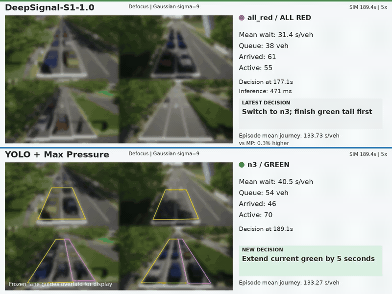

[Watch video](https://github.com/user-attachments/assets/3230897e-9a4c-4493-9d12-263f16cf9647) · [Static cover](assets/previews/en/nansha-df9.jpg)

### Standard simulation · Defocus σ=9

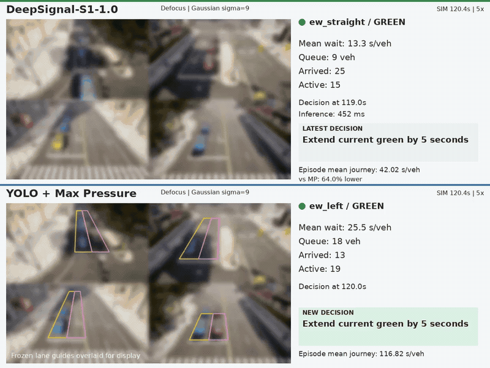

[Watch video](https://github.com/user-attachments/assets/84d65a84-5b20-4515-9fdd-f8ff73003a56) · [Static cover](assets/previews/en/town-df9.jpg)

</details>

<details open="open">
<summary>31 px motion blur</summary>

Nine-junction test: see the featured demos above.

### Standard simulation · 31 px motion blur

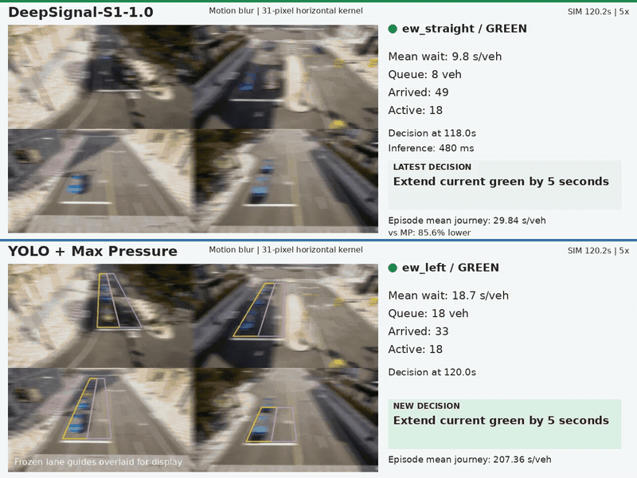

[Watch video](https://github.com/user-attachments/assets/b3b3a927-a5a5-4e43-9710-b94102f15bc4) · [Static cover](assets/previews/en/town-mb31.jpg)

</details>

<details open="open">
<summary>Fixed yaw ±15° / pitch ±8°</summary>

### Nine-junction test · Fixed yaw ±15° / pitch ±8°

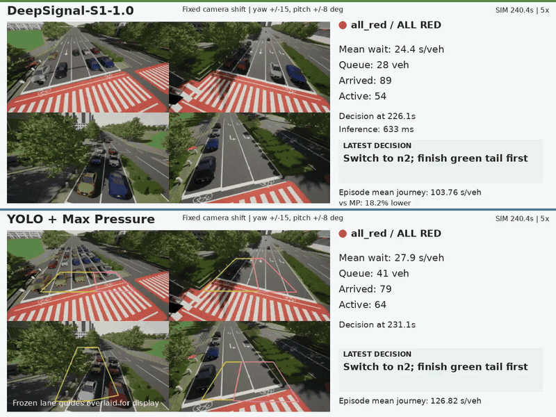

[Watch video](https://github.com/user-attachments/assets/fbeec8fa-af75-47da-9196-966038e1ad18) · [Static cover](assets/previews/en/nansha-angle15.jpg)

Standard simulation: see the featured demos above.

</details>

<details open="open">
<summary>Dynamic shake 5°</summary>

### Nine-junction test · Dynamic shake 5°

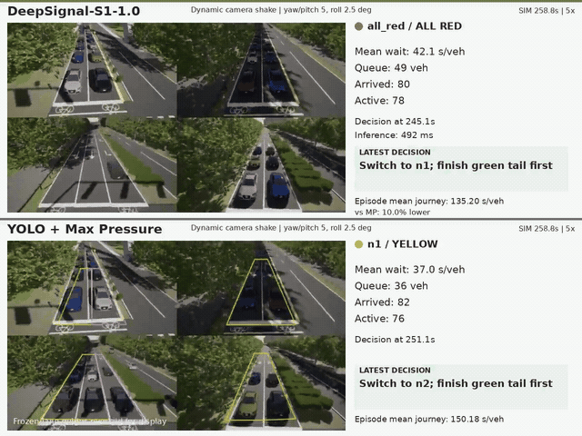

[Watch video](https://github.com/user-attachments/assets/28dfbfd5-ae9c-478e-8272-9e9c840242bc) · [Static cover](assets/previews/en/nansha-shake5.jpg)

### Standard simulation · Dynamic shake 5°

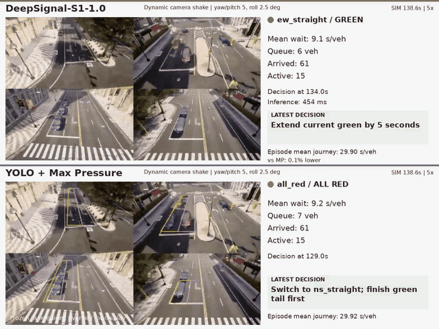

[Watch video](https://github.com/user-attachments/assets/9c9d2ac9-cc58-4959-8008-93ad5de7ca18) · [Static cover](assets/previews/en/town-shake5.jpg)

</details>
<!-- FUSION_GALLERY:END -->

Recorded scores belong to their individual episodes. In the defocus demo from the nine-junction evaluation, S1 journey time is slightly longer than YOLO+MP; the recording is retained. See [media notes](docs/media-delivery.md) for dynamic versus formal metrics.

Lane regions are calibrated on clean views and frozen; fixed shifts are not recalibrated. Dynamic shake peaks at 5° yaw/pitch and 2.5° roll.

### Clean-view videos

The GIF previews preserve the recordings' original 5× playback speed. Full MP4 files can be opened or downloaded.

<!-- FUSION_CLEAN_VIDEOS:BEGIN -->
<details open="open">
<summary>Video: Clean Nine-junction test: Three Controllers</summary>

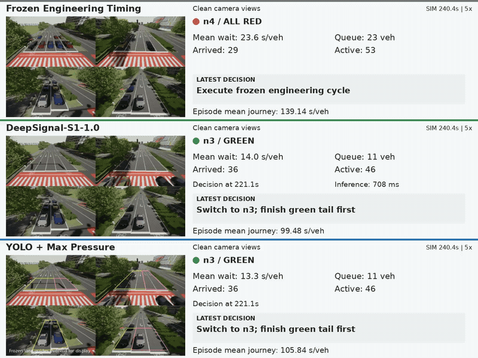

[Open / download MP4](https://github.com/AIMS-Laboratory/DeepSignal-S1/raw/refs/heads/main/assets/videos/s1-multi-intersection-clean-en.mp4)

</details>

<details open="open">
<summary>Video: Clean Standard simulation: Three Controllers</summary>

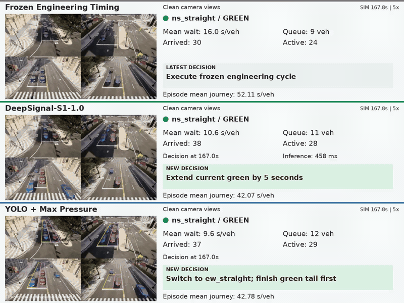

[Open / download MP4](https://github.com/AIMS-Laboratory/DeepSignal-S1/raw/refs/heads/main/assets/videos/s1-standard-simulation-clean-en.mp4)

</details>
<!-- FUSION_CLEAN_VIDEOS:END -->

Contact: [dalei@scu.edu.cn](mailto:dalei@scu.edu.cn)
