# DeepSignal S1

**从路口画面直接作出交通信号决策。**

DeepSignal 模型家族的视觉决策系列 · 当前版本 **DeepSignal-S1-1.0**

**S1 代表 System One**，强调快速、直接的视觉决策：结合路口画面与信号状态，输出合法控制动作。

[English](README.md) | 简体中文 · [品牌首页](https://github.com/AIMS-Laboratory/DeepSignal/blob/main/README_zh.md)

[看演示](#代表演示) · [看结果](#评测结果) · [试一次决策](#下载与快速开始) · [申请模型](https://huggingface.co/AIMS2025/DeepSignal-S1) · [完整复现](docs/reproduction.md)

<!-- FUSION_HIGHLIGHTS:BEGIN -->
## 核心创新与特色

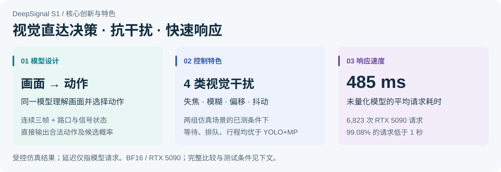

> [!IMPORTANT]
> **视觉理解与信号决策，在同一个模型里完成。**
> 连续三帧画面、路口信息与信号状态共同输入，直接返回合法控制动作及候选概率；无需独立的车辆检测与计数环节。

**速度实测：** 未量化BF16模型、RTX 5090、6,823次请求，平均 **485毫秒**，**99.08%** 低于一秒。 [工作原理](#工作原理) · [完整结果](#评测结果) · [延迟统计](#推理性能)
<!-- FUSION_HIGHLIGHTS:END -->

以上效果来自受控仿真；延迟仅计算模型请求，不包含相机采集、渲染和信号执行。

## 代表演示

观察画面变化、双方信号动作和排队差异。以下沿用已发布的标准仿真场景机位偏移与9个路口独立测试运动模糊案例，**以5倍速播放**；画面分数属于该次录制，整体效果以配对评测为准。动图与静态封面由GitHub直接提供，无需登录。

<!-- FUSION_FEATURED:BEGIN -->
### 标准仿真场景 · 固定偏航±15° / 俯仰±8°

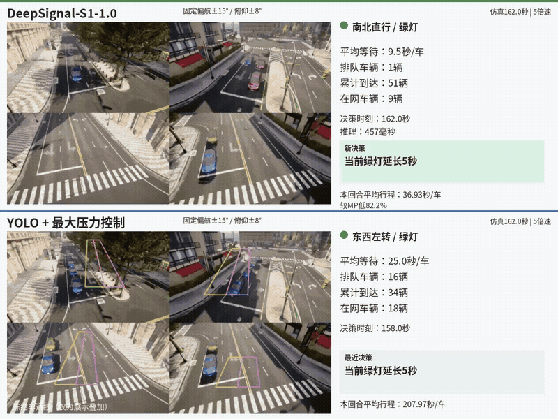

[观看视频](https://github.com/user-attachments/assets/029efc8f-dc94-4241-b5f0-a81985921d71) · [静态封面](assets/previews/zh/town-angle15.jpg)

### 9个路口独立测试 · 31像素运动模糊

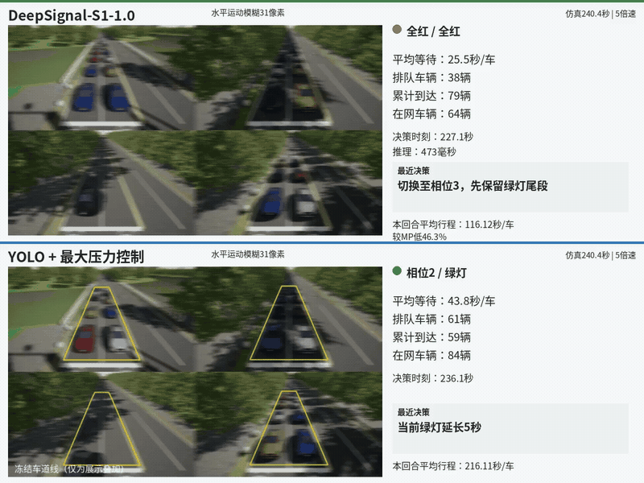

[观看视频](https://github.com/user-attachments/assets/d2561b6f-2333-4679-b404-fa3095468c73) · [静态封面](assets/previews/zh/nansha-mb31.jpg)
<!-- FUSION_FEATURED:END -->

## 评测结果

**两组场景，分别评测：**

- **9个路口独立测试：** 使用同一模型，分别在9个仿真路口进行测试，包含丁字和十字路口。每次独立控制一个路口，考察不同路口形态下的表现；此处未测试多路口协同控制。
- **标准仿真场景：** 采用CARLA仿真软件的 **Town10HD虚拟城市地图**，在其中1个十字路口测试5类车流；Town10HD是地图名称。

<!-- FUSION_RESULTS:BEGIN -->
本次评测关注直接视觉决策的交通控制效果，以及视觉输入变化对控制表现的影响。**YOLO+MP** 指由YOLO车辆检测与最大压力（Max Pressure）信号控制组成的方案；比较指标为车辆等待、排队和行程。

### 正常画面：与YOLO+MP相当，部分指标略优

在9个路口独立测试的72个案例中，S1相对YOLO+MP的平均行程降低 1.36%；标准仿真场景的五类车流中，两者平均行程基本持平。正常画面下，S1的整体控制表现可与YOLO+MP媲美，部分指标略优。

固定对照采用**经工程优化的合理固定配时方案**，参数在评测前确定并冻结，评测期间保持不变。与该方案相比，S1在上述两组场景的平均行程分别降低 **18.17%** 和 **33.77%**。

### 视觉干扰：输入变化下的控制表现

失焦、模糊、机位偏移和抖动可能影响车辆检测或车道区域匹配，继而影响基于检测计数的信号控制，这类影响可以预期。在本次两组场景、四类干扰的测试中，S1的平均等待、排队和行程均低于YOLO+MP。完整数据与全部八组图表见下方结果。

每类干扰在9个路口各测试1个案例，在标准仿真场景测试5个案例，均为单种子仿真。YOLO车道区域在正常机位标定后冻结，固定偏角测试不重新标定。结果适用于本次设置，尚不代表真实道路、夜间或恶劣天气验证。

<details open="open">
<summary>正常视觉：三方比较 — 完整数值与三指标图</summary>

<table>
<thead>
<tr><th scope="col">场景</th><th scope="col">条件</th><th scope="col">案例数</th><th scope="col">控制方法</th><th scope="col">平均等待（秒/车）</th><th scope="col">平均排队长度（辆）</th><th scope="col">平均行程（秒/车）</th></tr>
</thead>
<tbody>
<tr><td rowspan="3" align="center" valign="middle">9个路口独立测试</td><td rowspan="3" align="center" valign="middle">正常</td><td rowspan="3" align="center" valign="middle">72</td><td><strong>S1</strong></td><td align="right">45.82</td><td align="right">10.47</td><td align="right">107.32</td></tr>
<tr><td>固定配时方案</td><td align="right">68.55</td><td align="right">15.52</td><td align="right">131.15</td></tr>
<tr><td>YOLO+MP</td><td align="right">46.89</td><td align="right">10.56</td><td align="right">108.79</td></tr>
<tr><td rowspan="3" align="center" valign="middle">标准仿真场景</td><td rowspan="3" align="center" valign="middle">正常</td><td rowspan="3" align="center" valign="middle">5</td><td><strong>S1</strong></td><td align="right">20.45</td><td align="right">3.56</td><td align="right">38.22</td></tr>
<tr><td>固定配时方案</td><td align="right">40.46</td><td align="right">5.40</td><td align="right">57.70</td></tr>
<tr><td>YOLO+MP</td><td align="right">20.22</td><td align="right">3.59</td><td align="right">38.22</td></tr>
</tbody>
</table>

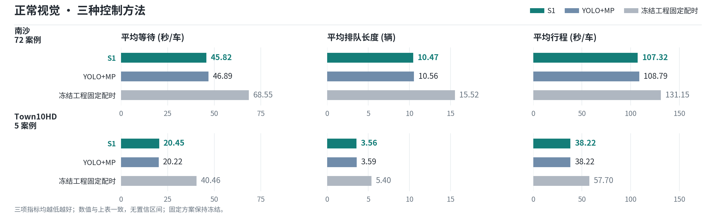

</details>

<details open="open">
<summary>特殊视觉：S1与YOLO+MP — 完整数值与三指标图</summary>

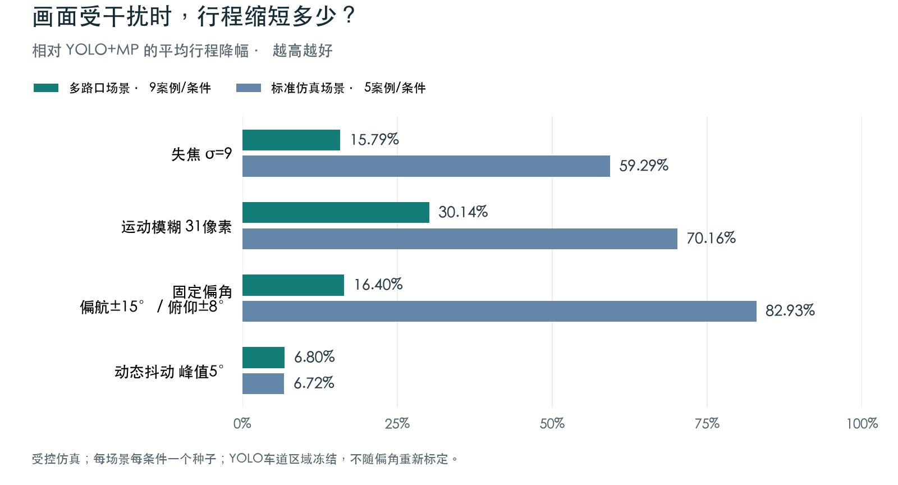

<table>
<thead>
<tr><th scope="col">场景</th><th scope="col">条件</th><th scope="col">案例数</th><th scope="col">控制方法</th><th scope="col">平均等待（秒/车）</th><th scope="col">平均排队长度（辆）</th><th scope="col">平均行程（秒/车）</th></tr>
</thead>
<tbody>
<tr><td rowspan="2" align="center" valign="middle">9个路口独立测试</td><td rowspan="2" align="center" valign="middle">失焦σ=9</td><td rowspan="2" align="center" valign="middle">9</td><td><strong>S1</strong></td><td align="right">76.08</td><td align="right">15.79</td><td align="right">141.03</td></tr>
<tr><td>YOLO+MP</td><td align="right">104.86</td><td align="right">31.04</td><td align="right">167.48</td></tr>
<tr><td rowspan="2" align="center" valign="middle">9个路口独立测试</td><td rowspan="2" align="center" valign="middle">31像素运动模糊</td><td rowspan="2" align="center" valign="middle">9</td><td><strong>S1</strong></td><td align="right">67.38</td><td align="right">17.23</td><td align="right">131.57</td></tr>
<tr><td>YOLO+MP</td><td align="right">124.59</td><td align="right">30.18</td><td align="right">188.34</td></tr>
<tr><td rowspan="2" align="center" valign="middle">9个路口独立测试</td><td rowspan="2" align="center" valign="middle">固定偏航±15° / 俯仰±8°</td><td rowspan="2" align="center" valign="middle">9</td><td><strong>S1</strong></td><td align="right">63.68</td><td align="right">15.44</td><td align="right">129.04</td></tr>
<tr><td>YOLO+MP</td><td align="right">87.01</td><td align="right">21.18</td><td align="right">154.36</td></tr>
<tr><td rowspan="2" align="center" valign="middle">9个路口独立测试</td><td rowspan="2" align="center" valign="middle">动态抖动峰值5°</td><td rowspan="2" align="center" valign="middle">9</td><td><strong>S1</strong></td><td align="right">63.40</td><td align="right">16.17</td><td align="right">128.25</td></tr>
<tr><td>YOLO+MP</td><td align="right">72.15</td><td align="right">17.91</td><td align="right">137.61</td></tr>
<tr><td rowspan="2" align="center" valign="middle">标准仿真场景</td><td rowspan="2" align="center" valign="middle">失焦σ=9</td><td rowspan="2" align="center" valign="middle">5</td><td><strong>S1</strong></td><td align="right">27.51</td><td align="right">4.10</td><td align="right">44.43</td></tr>
<tr><td>YOLO+MP</td><td align="right">92.97</td><td align="right">9.75</td><td align="right">109.15</td></tr>
<tr><td rowspan="2" align="center" valign="middle">标准仿真场景</td><td rowspan="2" align="center" valign="middle">31像素运动模糊</td><td rowspan="2" align="center" valign="middle">5</td><td><strong>S1</strong></td><td align="right">20.28</td><td align="right">3.58</td><td align="right">38.10</td></tr>
<tr><td>YOLO+MP</td><td align="right">111.26</td><td align="right">10.24</td><td align="right">127.71</td></tr>
<tr><td rowspan="2" align="center" valign="middle">标准仿真场景</td><td rowspan="2" align="center" valign="middle">固定偏航±15° / 俯仰±8°</td><td rowspan="2" align="center" valign="middle">5</td><td><strong>S1</strong></td><td align="right">19.23</td><td align="right">3.45</td><td align="right">37.11</td></tr>
<tr><td>YOLO+MP</td><td align="right">205.09</td><td align="right">13.67</td><td align="right">217.40</td></tr>
<tr><td rowspan="2" align="center" valign="middle">标准仿真场景</td><td rowspan="2" align="center" valign="middle">动态抖动峰值5°</td><td rowspan="2" align="center" valign="middle">5</td><td><strong>S1</strong></td><td align="right">19.13</td><td align="right">3.32</td><td align="right">37.20</td></tr>
<tr><td>YOLO+MP</td><td align="right">21.49</td><td align="right">3.53</td><td align="right">39.88</td></tr>
</tbody>
</table>

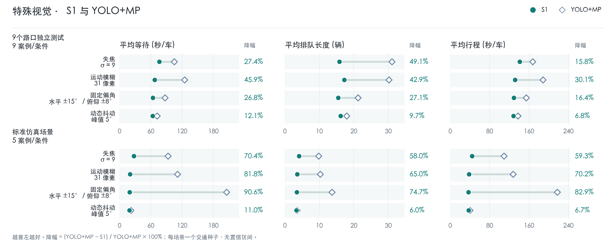

</details>

**指标说明：** 三项指标均越低越好。平均等待包括停车等待和入网等待；平均排队长度以停车车辆数计；平均行程从计划出发计时，未完成车辆计入评估截止时的已耗时。[详细指标定义](docs/traffic-metrics.md)。

<details>
<summary>详细结果解读与现实场景对应</summary>

### 结果解读

#### 正常视觉：验证直接视觉决策的可行性

正常画面下，S1的控制表现与YOLO+MP总体相当，部分指标略优；标准仿真场景的平均行程基本持平。这支持了直接从画面生成信号动作的可行性。当前有限场景与种子下的小幅差异，还需要更广泛评测来判断其稳定性。

#### 视觉干扰：理解输入变化对控制的影响

现实路口的车流未必改变，摄像头输入却可能因光照变化、设备维护或风振而发生变化。四类测试分别对应不同的成像问题，考察S1在画面不再清晰、稳定或保持原机位时，能否继续作出有效的信号决策。

- **失焦：对焦不准，车辆轮廓变软。** 夜间车灯等复杂光源可能干扰自动对焦，人工调焦或更换镜头后也可能没有重新调好焦点。车辆边缘和车道细节随之变得模糊，增加识别与计数的难度。
- **运动模糊：曝光期间的移动形成拖影。** 傍晚或夜间光照不足时，摄像头可能采用更长曝光；车辆运动或曝光期间的相机晃动便可能形成方向性拖影，使车辆形状和相邻车辆的边界更难分辨。
- **固定角度偏移：调整后稳定在新的机位。** 例如检修后重新调整视角，或支架发生偏转：画面已经稳定，但停车线和车道在图像中的位置改变了，原先画好的车道区域可能不再对应。我们的对比先在正常机位为YOLO画线，再固定改变相机角度，不重新画线。
- **动态抖动：视角随时间来回变化。** 高杆摄像头可能受到阵风或邻近重型车辆引起的振动影响，车辆和车道在连续画面中的位置随之摆动；这与调整后保持不动的固定偏角不同。

这组测试观察的是视觉输入变化对整套控制方案的影响。尤其在固定偏角条件下，检测质量和车道区域错位的影响可能叠加，结果应结合不重新标定的设置理解。更丰富的交通场景理解能力，需要通过专门的交通事件任务来验证。

上述测试模拟的是这些现实问题可能造成的视觉变化，不等同于已经完成夜间现场或真实恶劣天气验证。[现实场景对应与资料依据](docs/visual-robustness.md)。

#### 亚秒级决策：视觉模型也能快速响应

未量化模型在RTX 5090上的 **6823** 次决策请求平均耗时 **485毫秒**，**99.08%** 的请求低于1秒；稳态请求平均 **477毫秒**。System One直接输出结构化控制动作，无需等待长篇文字生成，让视觉理解、交通控制效果与快速响应能够同时兼顾。

</details>
<!-- FUSION_RESULTS:END -->

## 工作原理

连续三帧画面（4秒观察窗、间隔2秒）、静态路口信息、当前信号状态与合法动作共同输入模型；模型返回动作及候选动作概率。无需提供仿真车辆计数或未来到达计划。

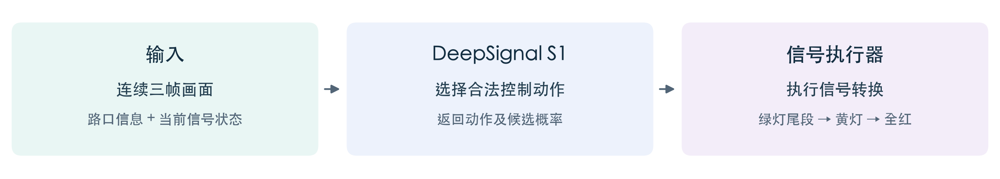

System One 强调快速、直接输出结构化决策，不生成逐字展开的长篇推理文字。S1借鉴 [Jev](https://typesafe.ai/blog/introducing-system-one-models-and-jev) 与 [OneJev](https://github.com/OmniJev/OneJev) 所体现的决策范式，在本地运行模型，不调用商业Jev服务。

同一份1.0权重用于9个不同路口（丁字和十字路口），以及标准仿真场景一个十字路口的五类车流。训练覆盖这些场景；此处不将跨场景使用等同于未见路口泛化验证。

## 推理性能

<!-- FUSION_LATENCY:BEGIN -->
| 范围 | 数量 | 平均 | 中位数 | P95 | 最大值 | 小于1秒 |
|---|---:|---:|---:|---:|---:|---:|
| 全部请求 | 6823 | 485.4 ms | 479.0 ms | 494.0 ms | 2304.0 ms | 99.08% |
| 每回合首请求 | 133 | 911.1 ms | 495.0 ms | 1460.2 ms | 2304.0 ms | 52.63% |
| 后续请求 | 6690 | 476.9 ms | 479.0 ms | 493.0 ms | 675.0 ms | 100.00% |
<!-- FUSION_LATENCY:END -->

统计覆盖133个S1评测案例、6823次决策请求，使用未量化BF16模型。延迟仅计算模型决策请求，不含相机采集、渲染及信号执行；首请求包含初始化影响。

**部署价值：** 亚秒级模型决策让消费级GPU信控工作站成为可考虑的落地方向。同时，我们也在 **RTX 4090** 上测试了未量化模型的推理速度，单次决策约 **900毫秒**；这是一项独立测试观测，测量条件尚未对齐，不计入上表。后续将探索量化与边缘部署，进一步降低算力需求。

### 运行要求

| 项目 | 当前说明 |
|---|---|
| 模型精度 | 未量化 BF16 |
| 已测试推理硬件 | RTX 5090；RTX 4090另有约900毫秒的独立观测 |
| 模型服务 | Linux、NVIDIA GPU、Python 3.12；安装完整模型包内的依赖 |
| 只试一次决策 | 使用仓库附带的三帧请求，无需启动仿真器 |
| 完整仿真 | Python 3.10、SUMO 1.18.0、匹配场景的CARLA环境；见复现说明 |

最低显存需求尚未形成经验证的公开配置；以上测试硬件不代表最低要求。

## 未来潜力与研究方向

**我们更看重S1通过场景理解拓展决策能力的潜力。** 视觉输入包含车辆数量之外的信息，例如道路是否被占用、拥堵由何种事件引起、不同交通参与者有什么通行需求。将这些信息与交通规则和信号状态结合，有望让模型针对更复杂的情况选择合适的动作，为后续能力提升打开更大的空间。

当前结果展示了直接视觉决策在受控仿真中的可行性。**我们团队正围绕以下方向推进下一阶段研究**，逐步验证上述潜力；复杂交通事件处理和多路口协同能力尚未完成验证。

- **从观察车流进一步走向理解交通场景。** 在补充场景数据、交通规则与安全约束的基础上，探索理解施工占道、事故阻塞、紧急车辆以及行人和非机动车集中通行等情况，判断事件如何影响可通行空间、放行顺序和下游拥堵风险，并据此调整信号动作。
- **从单路口决策扩展到多路口协同。** 探索共享相邻路口的排队、信号状态和到达车流信息，协调放行时机，研究干道绿波衔接、下游拥堵回溢抑制与区域通行效率提升。这需要新增通信机制和路网级评测。
- **验证更广的适用范围并降低部署成本。** 在未参与训练的新路口、夜间和恶劣天气下独立评测，并探索模型量化与边缘部署，进一步验证可迁移性、响应速度与算力需求。

## 下载与快速开始

- **看演示：** 本页预览、GitHub视频与[结果数据](results/fusion-2026-10-30.json)无需审批。
- **试一次决策：** 先在[模型页](https://huggingface.co/AIMS2025/DeepSignal-S1)申请访问，下载完整模型目录，然后按下方启动本地服务。
- **运行完整仿真：** 另行申请[场景资产](https://huggingface.co/datasets/AIMS2025/DeepSignal-S1-Scenes)，按[完整复现说明](docs/reproduction.md)配置v3资产与对应场景环境。

**1. 下载并启动模型服务**（Linux、NVIDIA GPU、Python 3.12；账号已获模型访问权限）：

```bash
git clone https://github.com/AIMS-Laboratory/DeepSignal-S1.git
cd DeepSignal-S1
python3.12 -m venv .venv-inference
.venv-inference/bin/pip install -U huggingface_hub
.venv-inference/bin/hf auth login
.venv-inference/bin/hf download AIMS2025/DeepSignal-S1 --local-dir ../DeepSignal-S1-model
.venv-inference/bin/pip install -r ../DeepSignal-S1-model/requirements.txt
.venv-inference/bin/python scripts/serve_model.py --model ../DeepSignal-S1-model --port 18404 --device cuda:0
```

**2. 在另一个终端发送仓库附带的真实三帧请求**（进入同一仓库目录）：

```bash
curl --fail http://127.0.0.1:18404/v1/decide \
  -H 'Content-Type: application/json' \
  --data-binary @examples/nansha-defocus-request.json
```

服务应报告版本 `DeepSignal-S1-1.0`，响应包含模型选择的动作及候选动作概率。该请求测试模型接口，不代表完成闭环交通评测。模型访问获批不提供远程托管API；从公开下载开始的完整闭环复跑尚未完成认证。

## 评测说明

- **经工程优化的固定基线：** 采用经工程优化的合理固定配时方案，参数在评测前确定并冻结，评测期间保持不变；9个路口独立测试使用已发布的各路口配时表，标准仿真场景使用`31/6/31/6秒`。
- **视觉对照：** 正常视觉比较三方，特殊视觉比较S1与YOLO+MP；相机偏移发生在YOLO画线之后，不重新标定。
- **适用范围：** 结果来自9个路口独立测试与标准仿真场景的受控仿真，真实道路和天气条件下的部署效果仍需验证。

详见[评测说明](docs/fusion-pilot-evaluation.md)、[指标定义](docs/comparisons.md)和[素材交付说明](docs/media-delivery.md)。

## 5类交通需求场景

<details>
<summary>展开车流参数和时间设置</summary>

<!-- TOWN_DEMAND:BEGIN -->
五类车流均设置在**同一个十字路口**，区别在方向分配、流量大小和高峰出现时点，而不是五个不同路口。下表列出当前评测使用的设置。

<table>
<thead>
<tr><th scope="col" nowrap="nowrap">交通需求场景</th><th scope="col" nowrap="nowrap">每个进口方向的流量<br/>（辆/小时）</th><th scope="col" nowrap="nowrap">时间变化</th><th scope="col" nowrap="nowrap">考察重点</th></tr>
</thead>
<tbody>
<tr><td nowrap="nowrap"><a href="https://github.com/AIMS-Laboratory/DeepSignal-S1/blob/main/reproduction/configs/vlm-realtime-control/episode-balanced.formal.json">均衡车流</a></td><td nowrap="nowrap">东、西、南、北各360</td><td nowrap="nowrap">全程恒定</td><td nowrap="nowrap">四向需求相近时<br/>的基本控制能力</td></tr>
<tr><td nowrap="nowrap"><a href="https://github.com/AIMS-Laboratory/DeepSignal-S1/blob/main/reproduction/configs/vlm-realtime-control/episode-sustained-uneven.formal.json">持续方向不均衡</a></td><td nowrap="nowrap">东、西各600<br/>南、北各120</td><td nowrap="nowrap">全程恒定<br/>主次方向流量比5:1</td><td nowrap="nowrap">持续向高需求方向<br/>分配绿灯</td></tr>
<tr><td nowrap="nowrap"><a href="https://github.com/AIMS-Laboratory/DeepSignal-S1/blob/main/reproduction/configs/vlm-realtime-control/ood-uneven125-6001.json">更高流量的不均衡</a></td><td nowrap="nowrap">东、西各750<br/>南、北各150</td><td nowrap="nowrap">全程恒定<br/>仍为5:1</td><td nowrap="nowrap">比上一类总需求增加25%<br/>考察较高负荷</td></tr>
<tr><td nowrap="nowrap"><a href="https://github.com/AIMS-Laboratory/DeepSignal-S1/blob/main/reproduction/configs/vlm-realtime-control/episode-time-varying.formal.json">时变高峰</a></td><td nowrap="nowrap">四向均为<br/>200 → 700 → 200</td><td nowrap="nowrap">0-60秒<br/>60-120秒<br/>120秒起</td><td nowrap="nowrap">适应车流上升<br/>及高峰消退</td></tr>
<tr><td nowrap="nowrap"><a href="https://github.com/AIMS-Laboratory/DeepSignal-S1/blob/main/reproduction/configs/vlm-realtime-control/ood-varyshuf-18040.json">高峰时序变化</a></td><td nowrap="nowrap">四向均为<br/>200 → 200 → 700</td><td nowrap="nowrap">0-60秒<br/>60-120秒<br/>120秒起</td><td nowrap="nowrap">改变高峰出现时点<br/>考察时序适应能力</td></tr>
</tbody>
</table>

流量是**每个进口方向**的期望到达率，不是每车道流量，也不是每小时固定生成的车辆数；车辆按该流率随机到达。五类均采用直行70%、左转15%、右转15%。时间从仿真启动计，末档流量保持至需求生成结束。“高峰时序变化”按种子重排时变流量，上表为当前结果对应的配置。各控制器使用相同的车辆计划。
<!-- TOWN_DEMAND:END -->

</details>

## 展示路口鸟瞰

<details>
<summary>展开路口鸟瞰与案例位置</summary>

### 9个路口独立测试 · 十字路口示例


### 标准仿真场景 · 十字路口


第一张鸟瞰图对应固定偏角演示；失焦、运动模糊和动态抖动演示选用其他十字路口。标准仿真场景的四组演示均使用第二张图中的同一个路口。具体案例对应关系见[素材说明](docs/media-delivery.md)。

</details>

## 八组特殊视觉

上方已展示两组代表案例；其余六组按干扰类型展开。每组均提供独立视频与静态封面。

<!-- FUSION_GALLERY:BEGIN -->
<details>
<summary>失焦σ=9</summary>

### 9个路口独立测试 · 失焦σ=9

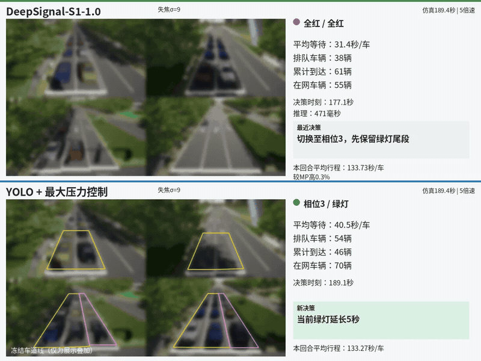

[观看视频](https://github.com/user-attachments/assets/f87f3efe-5ffd-483d-8a59-0ac73a578493) · [静态封面](assets/previews/zh/nansha-df9.jpg)

### 标准仿真场景 · 失焦σ=9

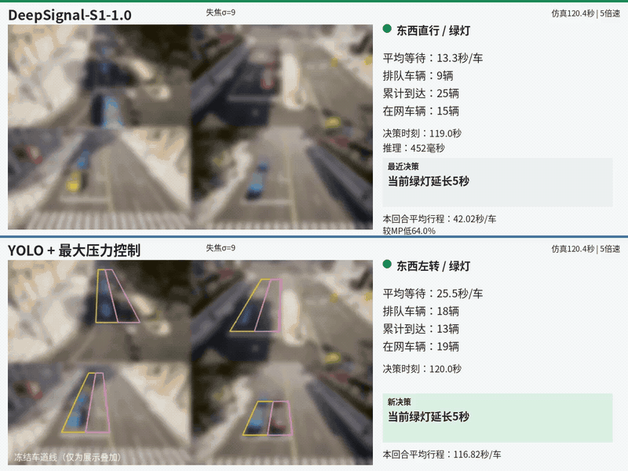

[观看视频](https://github.com/user-attachments/assets/dc64bac6-001d-42fd-ae0f-e58bbb6070af) · [静态封面](assets/previews/zh/town-df9.jpg)

</details>

<details>
<summary>31像素运动模糊</summary>

9个路口独立测试: 见上方代表演示。

### 标准仿真场景 · 31像素运动模糊

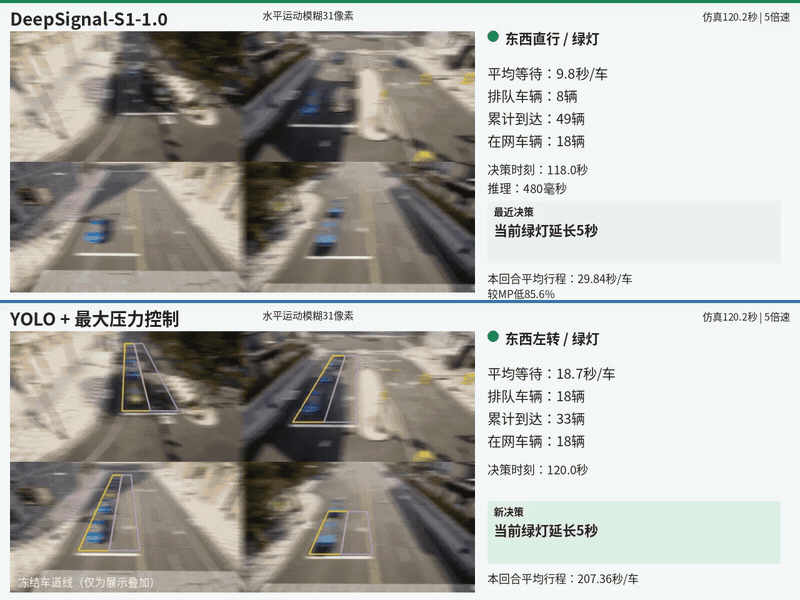

[观看视频](https://github.com/user-attachments/assets/f697bbca-f885-4a95-adab-412699c88de9) · [静态封面](assets/previews/zh/town-mb31.jpg)

</details>

<details>
<summary>固定偏航±15° / 俯仰±8°</summary>

### 9个路口独立测试 · 固定偏航±15° / 俯仰±8°

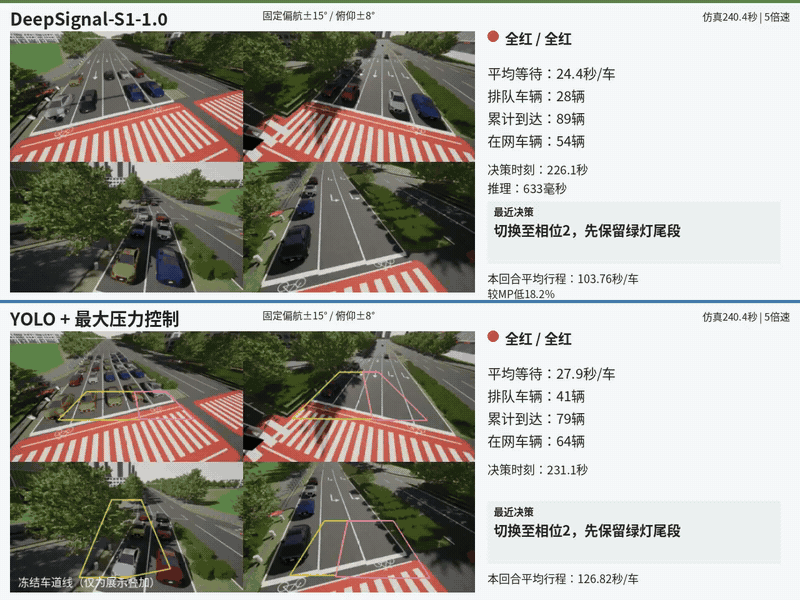

[观看视频](https://github.com/user-attachments/assets/199bbd0f-da7d-4d16-968d-89b0bf5de5fe) · [静态封面](assets/previews/zh/nansha-angle15.jpg)

标准仿真场景: 见上方代表演示。

</details>

<details>
<summary>动态抖动峰值5°</summary>

### 9个路口独立测试 · 动态抖动峰值5°

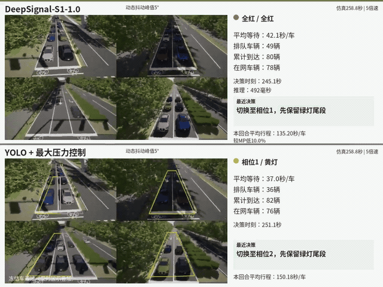

[观看视频](https://github.com/user-attachments/assets/8b6caf1c-393c-4668-95a8-3a62e980d1b7) · [静态封面](assets/previews/zh/nansha-shake5.jpg)

### 标准仿真场景 · 动态抖动峰值5°

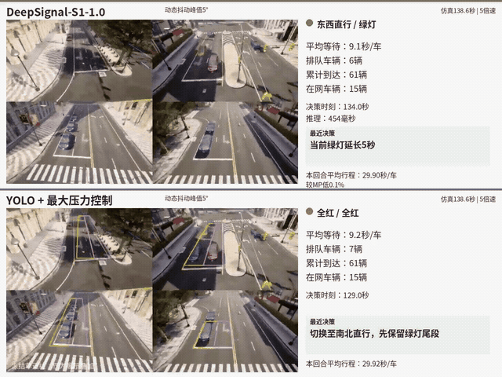

[观看视频](https://github.com/user-attachments/assets/658a8f96-ed06-44b4-b398-a1ca49b15ed7) · [静态封面](assets/previews/zh/town-shake5.jpg)

</details>
<!-- FUSION_GALLERY:END -->

录制分数仅属于对应回合；9个路口独立测试中的失焦演示，S1行程略长于YOLO+MP，仍如实保留。动态指标与正式评测口径见[素材说明](docs/media-delivery.md)。

YOLO车道画线在正常机位完成后冻结；固定偏角测试不重新标定。动态抖动的偏航/俯仰峰值5°、横滚峰值2.5°。

### 正常视觉视频

以下动图沿用原视频的5倍速播放，完整MP4可打开或下载。

<!-- FUSION_CLEAN_VIDEOS:BEGIN -->
<details>
<summary>视频：正常视觉：9个路口独立测试三方对比</summary>

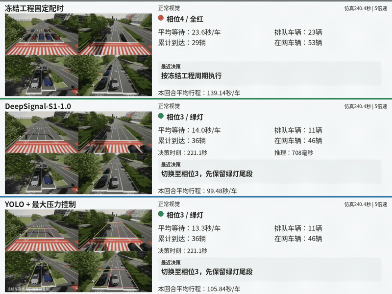

[打开 / 下载 MP4](https://github.com/AIMS-Laboratory/DeepSignal-S1/raw/refs/heads/main/assets/videos/s1-multi-intersection-clean-zh.mp4)

</details>

<details>
<summary>视频：正常视觉：标准仿真场景三方对比</summary>

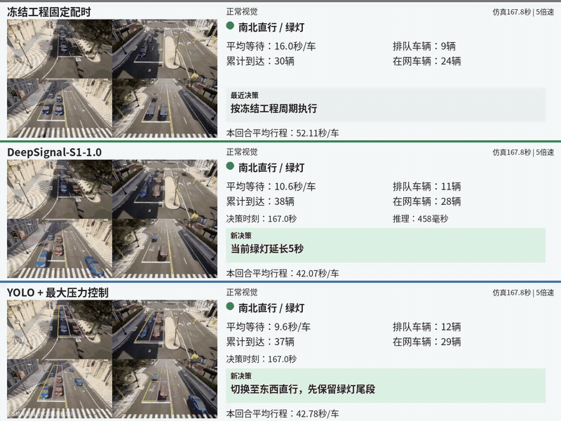

[打开 / 下载 MP4](https://github.com/AIMS-Laboratory/DeepSignal-S1/raw/refs/heads/main/assets/videos/s1-standard-simulation-clean-zh.mp4)

</details>
<!-- FUSION_CLEAN_VIDEOS:END -->

联系：[dalei@scu.edu.cn](mailto:dalei@scu.edu.cn)
