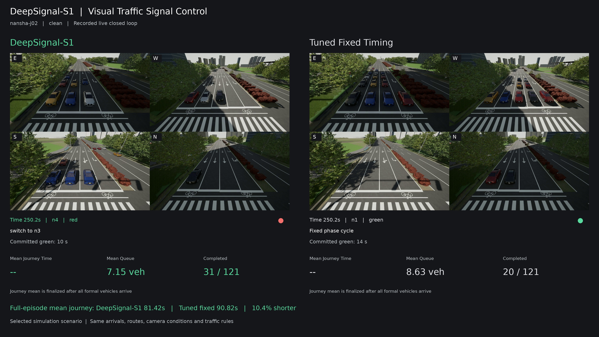
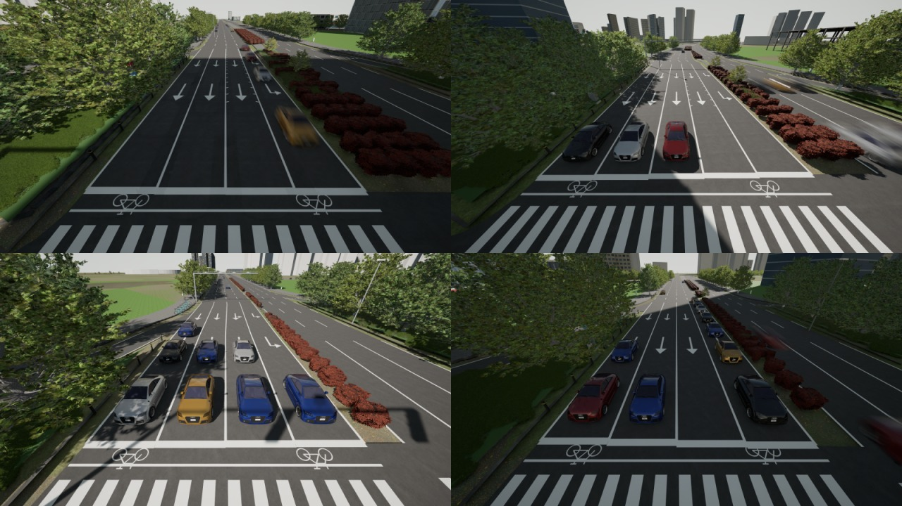

# DeepSignal-S1

**One system：从视觉交通观察到信号决策的一体化系统。**

[English](README.md) | 简体中文

**DeepSignal-S1 是面向实时交通信号控制、以视觉为主要交通观察输入的 System One 决策模型。S1 代表 one system**：将视觉交通理解与信号动作选择统一在一个多模态决策模型中。

DeepSignal-S1 采用 **Jev-style（以直接决策为核心）的功能定位**：接收路口摄像头画面与当前信号状态，直接选择允许执行的信号动作，而不是生成聊天式回答。交通观察来自画面，S1 控制器不需要单独的 YOLO 感知阶段。**YOLO+MP 是对照基线，不是 DeepSignal-S1 的组成模块。**

本仓库提供 DeepSignal-S1 的仿真测试场景、功能展示结果与模型调用客户端。完整模型文件与独立推理运行时通过 Hugging Face 单独提供。

## 对比视频

[](https://github.com/AIMS-Laboratory/DeepSignal-S1/releases/download/v0.1.0/DeepSignal-S1-vs-fixed.mp4)

**[观看 / 下载 4K 对比视频](https://github.com/AIMS-Laboratory/DeepSignal-S1/releases/download/v0.1.0/DeepSignal-S1-vs-fixed.mp4)** · YouTube 人工上传后补充正式链接。

**左侧 DeepSignal-S1，右侧调优固定配时。** 两个回合均以真实时间运行，采用 Epic 画质、相同车流计划和种子 99001；两侧 121 辆正式车辆均完成行程。完整平均行程为 **81.42 秒与 90.82 秒，缩短 10.35%**。

视频保持原速，展示真实信号动作和倒计时。此处为实际录制的单回合成绩，与下方三种子汇总分别统计。[录制回合数据](results/video-nansha-99001.json)。

## 与基线对比

| 控制方法 | 交通观察方式 | 控制方式 | 测试入口 |
| --- | --- | --- | --- |
| **DeepSignal-S1** | 摄像头画面与当前信号状态 | 自适应决策 | `--controller s1` |
| 工程固定配时 | 既有工程方案，不针对最终测试搜索 | 固定相位循环 | `--controller fixed` |
| YOLO+MP | YOLO 摄像头车辆检测 | 按各转向交通压力决策 | `--controller visual-pressure` |

### 选定视觉条件对比

测试日期为 **2026 年 10 月 25 日**。全部展示回合使用同一模型服务版本 **DeepSignal-S1-1.0-candidate**，每组包含三个新种子：**99001、99002、99003**。下表为按车辆数加权的完整平均行程时间，单位为秒，包含进入路网前的等待，**越低越好**。所有正式车辆均完成行程。

| 南沙 J02 车流 | 视觉条件 | DeepSignal-S1 | YOLO+MP | 相对 YOLO+MP 缩短 |
| --- | --- | ---: | ---: | ---: |
| 东西向需求偏高 | **失焦** | **80.42** | 82.19 | **2.15%** |
| 东西向需求偏高 | 清晰 | **78.85** | 80.75 | **2.36%** |
| 南北向需求偏高 | 清晰 | **91.62** | 93.55 | **2.06%** |

**失焦条件重点与 YOLO+MP 比较**，其他清晰条件也均包含 YOLO+MP 对照。两种视觉方法使用相同的失焦处理和观察时刻；固定配时不依赖摄像头画面。

[测试数据（JSON）](results/nansha-2026-10-25.json) · [表格（CSV）](results/nansha-2026-10-25.csv) · [对比口径](docs/comparisons.md)

以上为南沙 J02 选定场景的功能展示，不表述为每个种子、任意路口或所有视觉条件下均有收益。Town10HD 保留为可选测试场景，不计入主页展示结果。

### 工程固定配时测试

当前固定对照采用事先冻结的工程方案：南沙使用各路口既有配置（J02 为 **35/14/10/17 秒**），Town10HD 使用 **31/6/31/6 秒**，不针对最终测试车流搜索最优配时。**72 个南沙和 40 个 Town10HD 固定对照回合均已完成。** 在南沙 72 个清晰条件配对回合上，发布模型相对工程固定方案的逐回合截断平均行程汇总改善 **15.99%**。该有限时域指标与上方完整平均行程分别统计。[固定对照数据](results/engineering-fixed-2026-10-26.json) · [矩阵复现说明](docs/reproduction.md)。

现有视频和 10 月 25 日存档中的固定对照使用另一套调优参考表，保留原标签，不冒充此次工程固定方案的成绩。两个测试协议分别统计。

## 仿真场景



*南沙 J02，UE5 Epic 画质。本轮新闭环测试中的四路摄像头画面。*

## 运行测试

需要 Linux、Python **3.10** 和 SUMO。三维画面还需要配套 CARLA 0.10.0 场景包及 NVIDIA GPU，录制需要 FFmpeg。

```bash
python3.10 -m venv .venv
source .venv/bin/activate
pip install -e '.[test,download]'

deepsignal-s1 prepare --scene scenarios/nansha-j02/scene.json \
  --regime east-west --seed 99001 --output runs/example/plan.json

deepsignal-s1 run --scene scenarios/nansha-j02/scene.json \
  --plan runs/example/plan.json --controller fixed --cpu \
  --output runs/example/fixed
```

上述固定配时测试无需模型权限或三维素材。视觉闭环测试见[场景安装与模型访问](docs/testing.md)。

## 模型访问

Hugging Face 模型主页与 API 发布后将在这里添加链接。模型下载与 API 调用均需要申请并获批；访问本 GitHub 仓库不代表已获得模型权限。

获批下载完整模型后，也可以通过 `scripts/serve_model.py` 启动本地推理，不依赖远程 API。详见[本地推理与复现说明](docs/reproduction.md)。

获批后配置：

```bash
export HF_TOKEN="已获批账号的访问令牌"
export DEEPSIGNAL_ENDPOINT="分配给你的模型服务地址"
deepsignal-s1 run --scene scenarios/nansha-j02/scene.json \
  --plan runs/example/plan.json --controller s1 --port 25020 \
  --output runs/example/s1
```

运行前需启动场景服务器。测试不会用固定配时或历史答案替代模型返回结果。

## 测试产物

每个回合输出到达计划、逐车记录、信号时间线和结果报告。主要指标为完整平均行程时间，包含车辆进入仿真路网前的等待；不会删除未完成行程来获得更好的平均值。

对比双方使用同一到达计划。只有 `--realtime` 实测满足决策时限的回合才记录为实时运行，在线仿真录制不自动等于实时演示。

## 相关资源

- [测试场景与 API 使用](docs/testing.md)
- [统一场景包与原矩阵复现](docs/reproduction.md)
- [指标与对比口径](docs/comparisons.md)
- [此前 DeepSignal 项目](https://github.com/AIMS-Laboratory/DeepSignal)
- [场景素材及第三方说明](NOTICE.md)

联系：[dalei@scu.edu.cn](mailto:dalei@scu.edu.cn)
