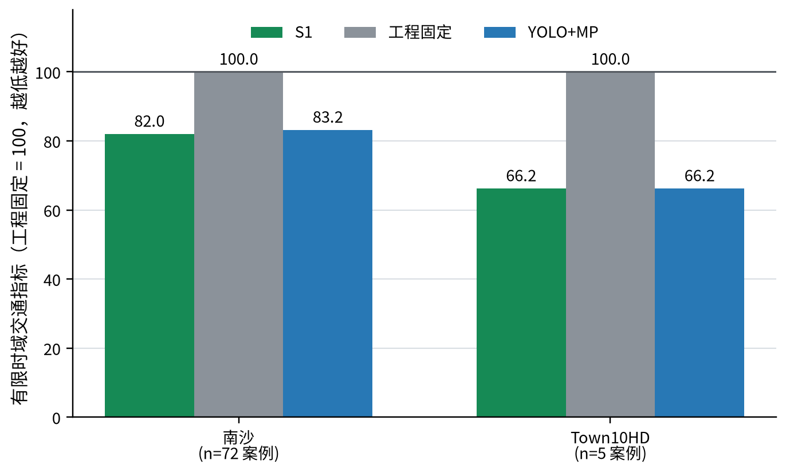
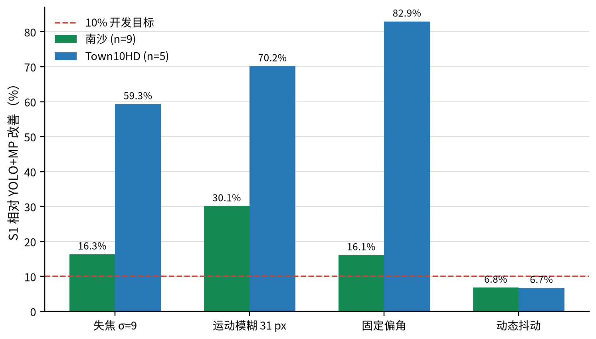
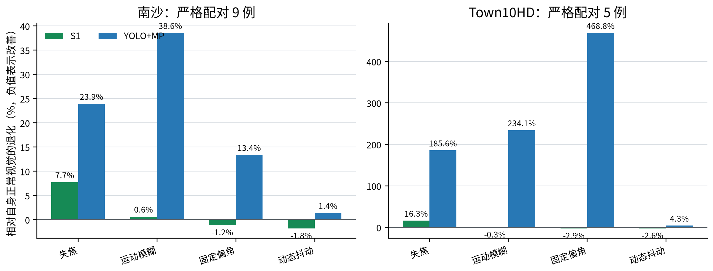
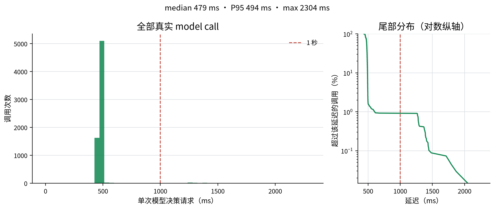

# DeepSignal-S1-1.0

**一个从视觉直接到信号决策的模型：正常画面能有效控制，摄像头受扰时仍保持稳健。**

[English](README.md) | 简体中文

[模型](https://huggingface.co/AIMS2025/DeepSignal-S1) · [场景](https://huggingface.co/datasets/AIMS2025/DeepSignal-S1-Scenes) · [结果数据](results/fusion-2026-10-30.json) · [复现说明](docs/reproduction.md)

DeepSignal-S1 根据连续三帧路口画面和当前信号上下文，直接输出合法信号动作。正式发布的 **DeepSignal-S1-1.0** 是南沙与 Town10HD 共用的同一份融合权重，不需要额外的YOLO感知阶段。

<!-- FUSION_HIGHLIGHTS:BEGIN -->
- **正常控制有效：** 相对冻结工程固定配时，南沙72案例改善 **17.98%**，Town五类车流改善 **33.77%**。
- **特殊视觉稳健：** 单独的固定机位偏移条件下，Town相对YOLO+MP改善 **82.93%**；31像素运动模糊条件下，南沙改善 **30.09%**。
- **三帧BF16决策：** RTX 5090共6823次模型请求，平均 **485毫秒**，中位数479毫秒。
<!-- FUSION_HIGHLIGHTS:END -->


*南沙 · 31像素运动模糊。S1与YOLO+MP使用同一交通计划并按相同仿真时刻对齐；60秒模拟窗口以5倍速播放。*


*Town10HD · 固定偏航±15° / 俯仰±8°。两臂使用同一交通计划并按相同仿真时刻对齐；60秒模拟窗口以5倍速播放。*

## 评测结果

有限时域行程指标越低越好。南沙与Town10HD的指标和时域不同，**不能合并绝对值**。正常视觉比较S1、冻结工程固定配时和YOLO+MP三方；特殊视觉只比较S1与YOLO+MP。

<!-- FUSION_RESULTS:BEGIN -->
### 正常视觉：三方比较

| 场景 | n | S1 | 工程固定 | YOLO+MP | S1比固定改善 | MP比固定改善 | S1比MP改善 |
|---|---:|---:|---:|---:|---:|---:|---:|
| 南沙 | 72 | 7540.24 | 9193.32 | 7648.36 | **17.98%** | **16.81%** | **1.41%** |
| Town10HD | 5 | 10623.80 | 16040.30 | 10625.20 | **33.77%** | **33.76%** | **0.01%** |

### 特殊视觉：仅与YOLO+MP比较

| 场景 | 条件 | n | S1 | YOLO+MP | S1改善 |
|---|---|---:|---:|---:|---:|
| 南沙 | 失焦σ=9 | 9 | 1257.39 | 1502.63 | **16.32%** |
| 南沙 | 31像素运动模糊 | 9 | 1174.58 | 1680.04 | **30.09%** |
| 南沙 | 固定偏航±15° / 俯仰±8° | 9 | 1153.65 | 1374.63 | **16.08%** |
| 南沙 | 动态抖动峰值5° | 9 | 1145.70 | 1229.37 | **6.81%** |
| Town10HD | 失焦σ=9 | 5 | 12351.90 | 30344.40 | **59.29%** |
| Town10HD | 31像素运动模糊 | 5 | 10592.30 | 35502.50 | **70.16%** |
| Town10HD | 固定偏航±15° / 俯仰±8° | 5 | 10315.80 | 60438.50 | **82.93%** |
| Town10HD | 动态抖动峰值5° | 5 | 10342.50 | 11087.20 | **6.72%** |

表内耗时是配对案例指标之和（秒），不是一辆车的平均耗时。南沙每案例使用1298秒时域的截断平均行程；Town每案例使用518秒时域的截断总行程。改善率按同场景、同条件的指标和计算。
<!-- FUSION_RESULTS:END -->







退化图中南沙与Town10HD两个面板使用独立纵轴范围。跨面板应比较数值标签，不能直接比较柱高。

南沙正常主表覆盖九个路口、预先确定的全部 **72** 个案例。特殊视觉小批范围更窄：南沙为种子97001的九个高流量均衡案例，Town10HD为种子18040的五类车流。这些是受控仿真结果，不代表统计显著、全面领先或任意真实道路都能复现。

录制案例展示真实视觉条件和控制行为，画面中的分数只属于该次录制；整体效果以以上配对表为准，不要求每个GIF案例都由S1获胜。

## 八组特殊视觉

<details><summary>展开南沙与Town10HD完整GIF画廊</summary>

| 场景 | 失焦σ=9 | 31像素运动模糊 |
|---|---|---|
| 南沙 |  |  |
| Town10HD |  |  |

| 场景 | 固定偏航±15° / 俯仰±8° | 动态抖动5° / 横滚2.5° |
|---|---|---|
| 南沙 |  |  |
| Town10HD |  |  |

</details>

YOLO车道画线先在正常机位完成并冻结。`angle15`在画线后改变机位，整回合保持固定，不重新标定；`shake5`的偏航和俯仰峰值为5°，横滚峰值为2.5°。

正常视频：[南沙](https://huggingface.co/datasets/AIMS2025/DeepSignal-S1-Scenes/resolve/main/media/fusion-1.0/nansha-clean.mp4) · [Town10HD](https://huggingface.co/datasets/AIMS2025/DeepSignal-S1-Scenes/resolve/main/media/fusion-1.0/town-clean.mp4)

## 推理性能



<!-- FUSION_LATENCY:BEGIN -->
| 范围 | 数量 | 平均 | 中位数 | P95 | 最大值 | 小于1秒 |
|---|---:|---:|---:|---:|---:|---:|
| 全部请求 | 6823 | 485.4 ms | 479.0 ms | 494.0 ms | 2304.0 ms | 99.08% |
| 每回合首请求 | 133 | 911.1 ms | 495.0 ms | 1460.2 ms | 2304.0 ms | 52.63% |
| 后续请求 | 6690 | 476.9 ms | 479.0 ms | 493.0 ms | 675.0 ms | 100.00% |
<!-- FUSION_LATENCY:END -->

当前未量化BF16模型输入四秒观察窗内的三帧画面。统计覆盖133个S1模型案例：南沙正常72案例和融合小批S1的61案例，不包含相机采集、渲染和控制执行。首请求包含初始化影响，后续请求更接近稳态。

**部署价值：** 消费级RTX 5090上的亚秒级稳态决策，使信控工作站成为切实可考虑的部署方向。同事另提供了未量化模型在**RTX 4090上约900毫秒**的观测，但测量条件尚未核对，因此不纳入正式统计。量化与边缘设备部署是后续优化方向，并非已经验证的能力；也不承诺所有请求都小于1秒。

## 下载与快速开始

模型采用申请审批制。当前版本沿用公开v3场景资产；只下载融合版媒体时，无需重复下载场景包。使用v3资产时，应配合GitHub最新代码。

```bash
python3.12 -m venv .venv-inference
source .venv-inference/bin/activate
pip install -U huggingface_hub
hf auth login
hf download AIMS2025/DeepSignal-S1 --local-dir ./DeepSignal-S1-model

deactivate

git clone https://github.com/AIMS-Laboratory/DeepSignal-S1.git DeepSignal-S1
cd DeepSignal-S1
python3.10 -m venv .venv
.venv/bin/pip install -e '.[test,reproduction,download]'
```

模型服务、无需启动仿真器的真实三帧请求示例，以及闭环命令见[复现说明](docs/reproduction.md)。请下载完整模型目录；模型获批不代表提供远程托管API。从公开下载开始的完整闭环复跑尚未完成认证。

## 评测边界

- **唯一固定基线：** 冻结工程固定配时，南沙使用各路口工程表，Town10HD使用`31/6/31/6秒`。
- **信号转换：** 适用时保留5秒绿灯尾段，再执行3秒黄灯和2秒全红。
- **有限时域：** 未完成车辆仍计入，不能称为完整行程平均值。
- **南沙已知限制：** 首次立即切相后，旧红龄记账可能多算一个最小绿灯时段。双方沿用相同协议，但本小批不能视为控制协议已全面验收。

详见[融合评测说明](docs/fusion-pilot-evaluation.md)、[指标定义](docs/comparisons.md)和[素材交付说明](docs/media-delivery.md)。

## 历史版本

此前 `DeepSignal-S1-1.0-candidate` 的南沙结果和历史Town专用权重继续按原协议归档，不属于融合1.0权重及其成绩。见[历史发布结果](docs/released-results.md)。

联系：[dalei@scu.edu.cn](mailto:dalei@scu.edu.cn)
