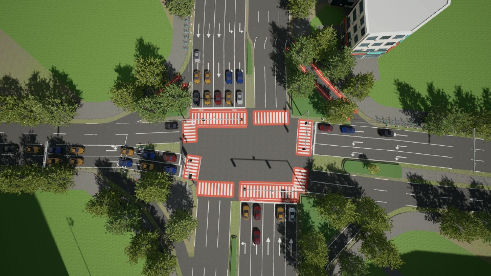
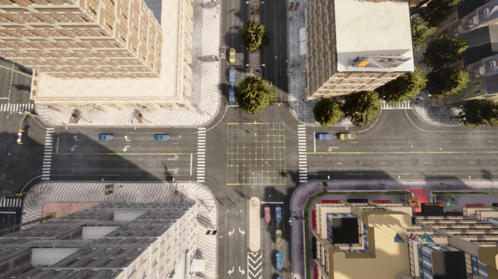

# DeepSignal-S1-1.0

**面向交通信号控制的多模态 System One（端到端快思考）模型：从路口视觉直接作出快速、结构化的控制决策。**

[English](README.md) | 简体中文

[模型](https://huggingface.co/AIMS2025/DeepSignal-S1) · [场景](https://huggingface.co/datasets/AIMS2025/DeepSignal-S1-Scenes) · [结果数据](results/fusion-2026-10-30.json) · [复现说明](docs/reproduction.md)

DeepSignal-S1 采用 **Jev 式结构化概率决策**路线：读取连续路口画面和信号状态，直接对候选控制动作给出概率并选择合法动作，而不是先生成长篇交通分析，再由外部程序解析文字。视觉理解与动作选择在同一个模型中完成，不依赖额外的YOLO车辆检测环节。

**DeepSignal-S1-1.0** 的训练覆盖**南沙9个路口的仿真场景**（包括丁字与十字交叉口），以及 **CARLA 官方 Town10HD 地图中1个十字交叉口的5类交通需求场景**，涵盖均衡、不均衡和时变车流。项目围绕两个实际问题展开：正常视觉下，能否比固定配时方案更有效；摄像头失焦、运动模糊或机位变化后，能否比“目标检测＋最大压力控制”更稳健。

## 为什么是 System One

System One（端到端快思考）强调快速、直接、可被软件调用的决策。[Jev](https://typesafe.ai/blog/introducing-system-one-models-and-jev)与开源[OneJev](https://github.com/OmniJev/OneJev)体现了这一模型范式。DeepSignal-S1 将这种决策方式用于交通信号控制，当前推理接口直接返回动作及其概率，不逐字生成解释或推理过程；它不是调用商业Jev服务。

- **从视觉到控制：** 时序路口画面与当前信号上下文共同决定动作，无需人工提供实时车辆计数。
- **结构化输出：** 在当前合法动作中直接决策，信号执行器负责既定的绿灯尾段、黄灯和全红转换。
- **适应不同路口：** 同一模型覆盖南沙的丁字及十字路口和Town10HD场景，不为每个场景更换权重。
- **面向本地部署：** 使用未量化模型验证消费级GPU上的决策延迟，量化与边缘部署仍是后续工作。

<!-- FUSION_HIGHLIGHTS:BEGIN -->
- **正常控制有效：** 相对固定配时方案，平均行程时间在南沙72案例降低 **18.17%**，在Town五类车流降低 **33.77%**。
- **正常视觉对标YOLO+MP：** 南沙平均行程进一步降低 **1.36%**，Town10HD基本持平，无需独立车辆检测环节。
- **特殊视觉稳健：** 固定机位偏移下，Town平均行程比YOLO+MP降低 **82.93%**；31像素运动模糊下，南沙降低 **30.14%**。
- **未量化本地推理：** RTX 5090共6823次模型请求，平均 **485毫秒**，中位数479毫秒。
<!-- FUSION_HIGHLIGHTS:END -->

## Town10HD的5类交通需求

<!-- TOWN_DEMAND:BEGIN -->
五类车流均设置在**同一个十字路口**，区别在方向分配、流量大小和高峰出现时点，而不是五个不同路口。下表列出当前评测使用的设置。

| 交通需求场景 | 每个进口方向的流量（辆/小时） | 时间变化 | 考察重点 |
|---|---|---|---|
| [均衡车流](reproduction/configs/vlm-realtime-control/episode-balanced.formal.json) | 东、西、南、北各360 | 全程恒定 | 四向需求相近时的基本控制能力 |
| [持续方向不均衡](reproduction/configs/vlm-realtime-control/episode-sustained-uneven.formal.json) | 东、西各600；南、北各120 | 全程恒定，主次方向流量比5:1 | 持续向高需求方向分配绿灯 |
| [更高流量的不均衡](reproduction/configs/vlm-realtime-control/ood-uneven125-6001.json) | 东、西各750；南、北各150 | 全程恒定，仍为5:1 | 比上一类总需求增加25%，考察较高负荷 |
| [时变高峰](reproduction/configs/vlm-realtime-control/episode-time-varying.formal.json) | 四向均为200 → 700 → 200 | 0-60秒 / 60-120秒 / 120秒起 | 适应车流上升及高峰消退 |
| [高峰时序变化](reproduction/configs/vlm-realtime-control/ood-varyshuf-18040.json) | 四向均为200 → 200 → 700 | 0-60秒 / 60-120秒 / 120秒起 | 改变高峰出现时点，考察时序适应能力 |

流量是**每个进口方向**的期望到达率，不是每车道流量，也不是每小时固定生成的车辆数；车辆按该流率随机到达。五类均采用直行70%、左转15%、右转15%。时间从仿真启动计，末档流量保持至需求生成结束。“高峰时序变化”按种子重排时变流量，上表为当前结果对应的配置。各控制器使用相同的车辆计划。
<!-- TOWN_DEMAND:END -->

## Town10HD：机位改变后仍直接决策


*Town10HD · 固定偏航±15° / 俯仰±8°。两臂使用同一交通计划并按相同仿真时刻对齐；60秒模拟窗口以5倍速播放。*

## 评测结果

以下比较**平均每车等待时间、平均排队长度和平均每车行程时间**，三项指标均越低越好。正常视觉比较S1、固定配时方案和YOLO+MP三方；特殊视觉比较S1与YOLO+MP。

<!-- FUSION_RESULTS:BEGIN -->
### 正常视觉：三方比较

<table>
<thead>
<tr><th scope="col">场景</th><th scope="col">条件</th><th scope="col">案例数</th><th scope="col">控制方法</th><th scope="col">平均等待（秒/车）</th><th scope="col">平均排队长度（辆）</th><th scope="col">平均行程（秒/车）</th></tr>
</thead>
<tbody>
<tr><td rowspan="3" align="center" valign="middle">南沙</td><td rowspan="3" align="center" valign="middle">正常</td><td rowspan="3" align="center" valign="middle">72</td><td><strong>S1</strong></td><td align="right">45.82</td><td align="right">10.47</td><td align="right">107.32</td></tr>
<tr><td>固定配时方案</td><td align="right">68.55</td><td align="right">15.52</td><td align="right">131.15</td></tr>
<tr><td>YOLO+MP</td><td align="right">46.89</td><td align="right">10.56</td><td align="right">108.79</td></tr>
<tr><td rowspan="3" align="center" valign="middle">Town10HD</td><td rowspan="3" align="center" valign="middle">正常</td><td rowspan="3" align="center" valign="middle">5</td><td><strong>S1</strong></td><td align="right">20.45</td><td align="right">3.56</td><td align="right">38.22</td></tr>
<tr><td>固定配时方案</td><td align="right">40.46</td><td align="right">5.40</td><td align="right">57.70</td></tr>
<tr><td>YOLO+MP</td><td align="right">20.22</td><td align="right">3.59</td><td align="right">38.22</td></tr>
</tbody>
</table>

### 特殊视觉：S1与YOLO+MP

<table>
<thead>
<tr><th scope="col">场景</th><th scope="col">条件</th><th scope="col">案例数</th><th scope="col">控制方法</th><th scope="col">平均等待（秒/车）</th><th scope="col">平均排队长度（辆）</th><th scope="col">平均行程（秒/车）</th></tr>
</thead>
<tbody>
<tr><td rowspan="2" align="center" valign="middle">南沙</td><td rowspan="2" align="center" valign="middle">失焦σ=9</td><td rowspan="2" align="center" valign="middle">9</td><td><strong>S1</strong></td><td align="right">76.08</td><td align="right">15.79</td><td align="right">141.03</td></tr>
<tr><td>YOLO+MP</td><td align="right">104.86</td><td align="right">31.04</td><td align="right">167.48</td></tr>
<tr><td rowspan="2" align="center" valign="middle">南沙</td><td rowspan="2" align="center" valign="middle">31像素运动模糊</td><td rowspan="2" align="center" valign="middle">9</td><td><strong>S1</strong></td><td align="right">67.38</td><td align="right">17.23</td><td align="right">131.57</td></tr>
<tr><td>YOLO+MP</td><td align="right">124.59</td><td align="right">30.18</td><td align="right">188.34</td></tr>
<tr><td rowspan="2" align="center" valign="middle">南沙</td><td rowspan="2" align="center" valign="middle">固定偏航±15° / 俯仰±8°</td><td rowspan="2" align="center" valign="middle">9</td><td><strong>S1</strong></td><td align="right">63.68</td><td align="right">15.44</td><td align="right">129.04</td></tr>
<tr><td>YOLO+MP</td><td align="right">87.01</td><td align="right">21.18</td><td align="right">154.36</td></tr>
<tr><td rowspan="2" align="center" valign="middle">南沙</td><td rowspan="2" align="center" valign="middle">动态抖动峰值5°</td><td rowspan="2" align="center" valign="middle">9</td><td><strong>S1</strong></td><td align="right">63.40</td><td align="right">16.17</td><td align="right">128.25</td></tr>
<tr><td>YOLO+MP</td><td align="right">72.15</td><td align="right">17.91</td><td align="right">137.61</td></tr>
<tr><td rowspan="2" align="center" valign="middle">Town10HD</td><td rowspan="2" align="center" valign="middle">失焦σ=9</td><td rowspan="2" align="center" valign="middle">5</td><td><strong>S1</strong></td><td align="right">27.51</td><td align="right">4.10</td><td align="right">44.43</td></tr>
<tr><td>YOLO+MP</td><td align="right">92.97</td><td align="right">9.75</td><td align="right">109.15</td></tr>
<tr><td rowspan="2" align="center" valign="middle">Town10HD</td><td rowspan="2" align="center" valign="middle">31像素运动模糊</td><td rowspan="2" align="center" valign="middle">5</td><td><strong>S1</strong></td><td align="right">20.28</td><td align="right">3.58</td><td align="right">38.10</td></tr>
<tr><td>YOLO+MP</td><td align="right">111.26</td><td align="right">10.24</td><td align="right">127.71</td></tr>
<tr><td rowspan="2" align="center" valign="middle">Town10HD</td><td rowspan="2" align="center" valign="middle">固定偏航±15° / 俯仰±8°</td><td rowspan="2" align="center" valign="middle">5</td><td><strong>S1</strong></td><td align="right">19.23</td><td align="right">3.45</td><td align="right">37.11</td></tr>
<tr><td>YOLO+MP</td><td align="right">205.09</td><td align="right">13.67</td><td align="right">217.40</td></tr>
<tr><td rowspan="2" align="center" valign="middle">Town10HD</td><td rowspan="2" align="center" valign="middle">动态抖动峰值5°</td><td rowspan="2" align="center" valign="middle">5</td><td><strong>S1</strong></td><td align="right">19.13</td><td align="right">3.32</td><td align="right">37.20</td></tr>
<tr><td>YOLO+MP</td><td align="right">21.49</td><td align="right">3.53</td><td align="right">39.88</td></tr>
</tbody>
</table>

**指标说明：** 三项指标均越低越好。平均等待包括停车等待和入网等待；平均排队长度以停车车辆数计；平均行程从计划出发计时，未完成车辆计入评估截止时的已耗时。[详细指标定义](docs/traffic-metrics.md)。

### 结果解读

#### 正常视觉：高水平控制，不依赖独立车辆检测

与固定配时方案相比，S1在南沙和Town10HD的平均行程分别降低 **18.17%** 和 **33.77%**，平均等待分别降低 **33.15%** 和 **49.45%**。收益不仅是车辆更早到达，也体现在更少的停车等待与更短的排队。

与YOLO+MP相比，S1在南沙的平均行程再降低 **1.36%**、平均等待降低 **2.28%**；Town10HD的平均行程基本持平。这说明，直接从视觉作出信号决策，可以在省去独立检测环节的同时达到有竞争力的交通控制效果，并在南沙取得小幅领先。

#### 特殊视觉：更值得关注的部署优势

现实路口的车流未必改变，摄像头输入却可能因光照变化、设备维护或风振而发生变化。四类测试分别对应不同的成像问题，考察S1在画面不再清晰、稳定或保持原机位时，能否继续作出有效的信号决策。

- **失焦：对焦不准，车辆轮廓变软。** 夜间车灯等复杂光源可能干扰自动对焦，人工调焦或更换镜头后也可能没有重新调好焦点。车辆边缘和车道细节随之变得模糊，增加识别与计数的难度。在失焦测试中，S1相对YOLO+MP的平均行程在南沙、Town分别降低 **15.79%**、**59.29%**。
- **运动模糊：曝光期间的移动形成拖影。** 傍晚或夜间光照不足时，摄像头可能采用更长曝光；车辆运动或曝光期间的相机晃动便可能形成方向性拖影，使车辆形状和相邻车辆的边界更难分辨。在运动模糊测试中，S1的平均行程分别降低 **30.14%**、**70.16%**。
- **固定角度偏移：调整后稳定在新的机位。** 例如检修后重新调整视角，或支架发生偏转：画面已经稳定，但停车线和车道在图像中的位置改变了，原先画好的车道区域可能不再对应。我们的对比先在正常机位为YOLO画线，再固定改变相机角度，不重新画线。S1的平均行程在南沙降低 **16.40%**，在Town降低 **82.93%**；Town的平均等待同时降低 **90.63%**。
- **动态抖动：视角随时间来回变化。** 高杆摄像头可能受到阵风或邻近重型车辆引起的振动影响，车辆和车道在连续画面中的位置随之摆动；这与调整后保持不动的固定偏角不同。动态抖动测试中，S1的平均行程在南沙、Town分别降低 **6.80%**、**6.72%**。抖动下仍有收益，模糊和机位偏移下的优势更突出。

这些变化既可能影响车辆检测与计数，也可能使画面与原有车道区域错位，进而影响依赖检测计数的信号控制。S1直接依据时序画面和信号状态决策，不依赖这条独立检测计数链路。在本次两个场景、四种特殊视觉条件的对比中，S1的平均等待、平均排队长度和平均行程均低于YOLO+MP，体现出对这些输入变化的鲁棒性，优势直接落在车辆少等待、少排队和平均行程更短上。

上述测试模拟的是这些现实问题可能造成的视觉变化，不等同于已经完成夜间现场或真实恶劣天气验证。[现实场景对应与资料依据](docs/visual-robustness.md)。

#### 亚秒级决策：视觉模型也能快速响应

未量化模型在RTX 5090上的 **6823** 次决策请求平均耗时 **485毫秒**，**99.08%** 的请求低于1秒；稳态请求平均 **477毫秒**。System One直接输出结构化控制动作，无需等待长篇文字生成，让视觉理解、交通控制效果与快速响应能够同时兼顾。
<!-- FUSION_RESULTS:END -->

**评测规模：** 正常视觉覆盖南沙9个路口的72案例和Town10HD的5类车流；四种特殊视觉条件下，每种分别覆盖南沙9案例和Town10HD 5案例。特殊视觉为单种子仿真评测。

录制案例展示真实视觉条件和控制行为，画面中的分数只属于该次录制；整体效果以以上配对表为准。

## 展示路口鸟瞰

### 南沙 · J03十字路口



### Town10HD · 十字路口



南沙固定偏角示例使用J03，失焦、运动模糊和动态抖动示例分别使用J08、J05和J07；Town10HD四组示例均来自上图同一十字路口。

## 八组特殊视觉

<!-- FUSION_GALLERY:BEGIN -->
### Town10HD

#### Town10HD · 固定偏航±15° / 俯仰±8°


https://github.com/user-attachments/assets/029efc8f-dc94-4241-b5f0-a81985921d71

#### Town10HD · 失焦σ=9


#### Town10HD · 31像素运动模糊


#### Town10HD · 动态抖动峰值5°


### 南沙

#### 南沙 · 固定偏航±15° / 俯仰±8°


#### 南沙 · 失焦σ=9


#### 南沙 · 31像素运动模糊


https://github.com/user-attachments/assets/d2561b6f-2333-4679-b404-fa3095468c73

#### 南沙 · 动态抖动峰值5°


<!-- FUSION_GALLERY:END -->

动图展示模型实际看到的画面、实时交通指标与最近一次真实决策。动态指标反映录制回合的统计，整体效果以结果表为准；[动态指标口径](docs/media-delivery.md)另有说明。

YOLO车道画线先在正常机位完成并冻结。`angle15`在画线后改变机位，整回合保持固定，不重新标定；`shake5`的偏航和俯仰峰值为5°，横滚峰值为2.5°。

<!-- FUSION_CLEAN_VIDEOS:BEGIN -->
### 正常视觉：南沙三方对比

https://github.com/user-attachments/assets/de7933ba-fcd9-42a6-befd-48b0e0c51cf8

### 正常视觉：Town10HD三方对比

https://github.com/user-attachments/assets/f2e37b49-8b1a-4d2a-83a7-a6e19b0e548a
<!-- FUSION_CLEAN_VIDEOS:END -->

## 推理性能

<!-- FUSION_LATENCY:BEGIN -->
| 范围 | 数量 | 平均 | 中位数 | P95 | 最大值 | 小于1秒 |
|---|---:|---:|---:|---:|---:|---:|
| 全部请求 | 6823 | 485.4 ms | 479.0 ms | 494.0 ms | 2304.0 ms | 99.08% |
| 每回合首请求 | 133 | 911.1 ms | 495.0 ms | 1460.2 ms | 2304.0 ms | 52.63% |
| 后续请求 | 6690 | 476.9 ms | 479.0 ms | 493.0 ms | 675.0 ms | 100.00% |
<!-- FUSION_LATENCY:END -->

统计覆盖133个S1评测案例、6823次决策请求，使用未量化BF16模型。延迟仅计算模型决策请求，不含相机采集、渲染及信号执行；首请求包含初始化影响。

**部署价值：** 亚秒级模型决策让消费级GPU信控工作站成为可考虑的落地方向。同时，我们也在 **RTX 4090** 上测试了未量化模型的推理速度，单次决策约 **900毫秒**；这是一项独立测试观测，测量条件尚未对齐，不计入上表。后续将探索量化与边缘部署，进一步降低算力需求。

## 下载与快速开始

模型与仿真资产下载分别需要申请审批。GIF、视频和结果数据在[DeepSignal-S1-Media](https://huggingface.co/datasets/AIMS2025/DeepSignal-S1-Media)免费公开，无需审批。当前版本沿用v3场景资产并配合GitHub最新代码；观看媒体无需下载场景包。

```bash
python3.12 -m venv .venv-inference
source .venv-inference/bin/activate
pip install -U huggingface_hub
hf auth login
hf download AIMS2025/DeepSignal-S1 --local-dir ./DeepSignal-S1-model

deactivate

git clone https://github.com/AIMS-Laboratory/DeepSignal-S1.git DeepSignal-S1
cd DeepSignal-S1
python3.10 -m venv .venv
.venv/bin/pip install -e '.[test,reproduction,download]'
```

模型服务、无需启动仿真器的真实三帧请求示例，以及闭环命令见[复现说明](docs/reproduction.md)。请下载完整模型目录；模型获批不代表提供远程托管API。从公开下载开始的完整闭环复跑尚未完成认证。

## 评测说明

- **唯一固定基线：** 固定配时方案，评测期间保持配时参数不变；南沙使用已发布的各路口配时表，Town10HD使用`31/6/31/6秒`。
- **视觉对照：** 正常视觉比较三方，特殊视觉比较S1与YOLO+MP；相机偏移发生在YOLO画线之后，不重新标定。
- **适用范围：** 结果来自南沙与Town10HD的受控仿真，真实道路和天气条件下的部署效果仍需验证。

详见[评测说明](docs/fusion-pilot-evaluation.md)、[指标定义](docs/comparisons.md)和[素材交付说明](docs/media-delivery.md)。

## 历史版本

此前 `DeepSignal-S1-1.0-candidate` 的南沙结果和历史Town专用权重继续按原协议归档，与当前1.0版本及其成绩区分。见[历史发布结果](docs/released-results.md)。

联系：[dalei@scu.edu.cn](mailto:dalei@scu.edu.cn)
